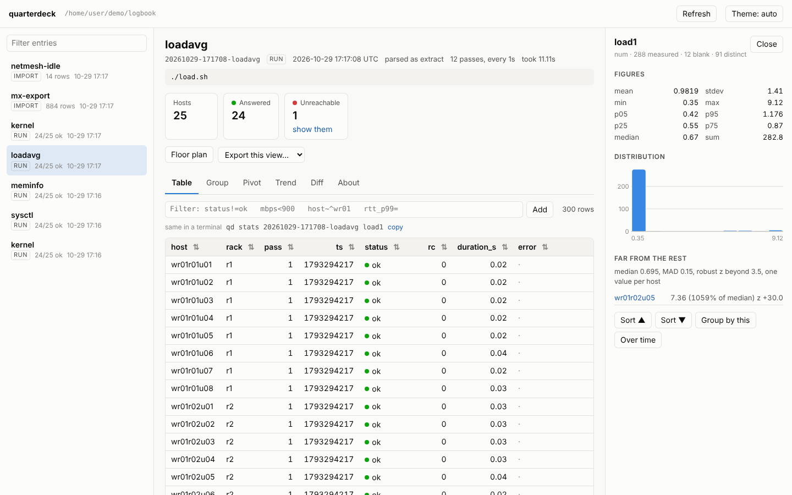
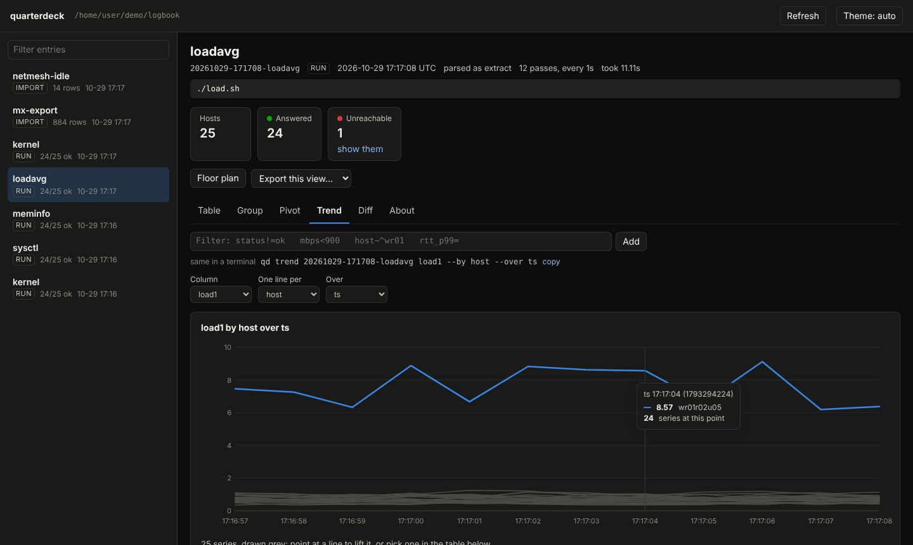

<!--
SPDX-License-Identifier: GPL-3.0-or-later
SPDX-FileCopyrightText: 2026 Martin J. Gallagher
-->

# quarterdeck (`qd`)

[](https://github.com/MartinGallagher-code/quarterdeck/actions/workflows/ci.yml)
[](https://www.gnu.org/licenses/gpl-3.0.html)
[](https://api.reuse.software/info/github.com/MartinGallagher-code/quarterdeck)

The quarterdeck is where a ship is commanded from: the binnacle's
instruments are read there and the log is kept there. This one does three
things for a fleet of Linux boxes:

1. **Runs a command on every host and keeps every answer as a dataset.**
   It doesn't just show you N screens of output: each host is a row,
   whatever it printed is parsed into columns, and a host that didn't
   answer is a row too.
2. **Drives the rest of the toolchain and keeps what it leaves.**
   [binnacle](https://github.com/MartinGallagher-code/binnacle),
   [matrix_orchestrator](https://github.com/MartinGallagher-code/matrix_orchestrator) (`mx`),
   [iperf_orchestrator](https://github.com/MartinGallagher-code/iperf_orchestrator) and
   [datacenter_visualization](https://github.com/MartinGallagher-code/datacenter_visualization)
   (`dcprobe`, the floor plan) all write files. `qd do` runs one and reads
   its output back into the same logbook, in the same shape.
3. **Reads any of it back, any way you like.** Statistics, value counts
   (who agrees and who doesn't), histograms, robust outliers, group-bys,
   pivots, trends and diffs between runs. You can read them as text, as
   CSV/JSON, in a full-screen terminal explorer, in a browser, or painted
   on the floor plan.

```bash
git clone https://github.com/MartinGallagher-code/quarterdeck
./quarterdeck/qd hints                   # runs from the clone, nothing installed
pip install ./quarterdeck                # or put qd (and quarterdeck) on PATH
```

No dependencies, Python 3.6+, standard library only. Nothing is installed
on the fleet and nothing is left running there. All it needs is key-based
ssh, which the rest of the toolchain needs anyway.

---

## Thirty seconds

```bash
printf '%s\n' 'node[01-24] rack=r1' 'node[25-48] rack=r2' > hosts.txt

qd run -- uname -r                       # every host, every answer, kept
qd freq latest stdout                    # who runs which kernel
qd run --extract load1='^(\S+)' -- cat /proc/loadavg
qd stats latest load1 --by rack          # centre and spread, per rack
qd outliers latest load1                 # who is far from everybody else
qd diff latest                           # against the last time this ran
qd web                                   # all of it, in a browser
```

```text
qd run -- uname -r: 48 hosts, 46 ok, 2 unreachable   [parsed as text]
  logbook  logbook/20261029-142233-uname  (48 rows)

  DID NOT ANSWER
    node09  unreachable      ssh: connect to host node09 port 22: Connection timed out
    node31  unreachable      ssh: connect to host node31 port 22: Connection timed out

  host    stdout
  node01  6.1.0-18-amd64
  ...

  WHAT TO DO NEXT
    * qd show latest --where status!=ok  the 2 hosts that did not answer, with why
    * reachable hosts.txt -i             binnacle: comment dead entries out of the list
    * qd freq latest stdout              2 different answers: who said which
    * qd view latest                     explore it full-screen
```

---

## What it keeps: the logbook

Every `qd run`, `qd do` and `qd import` makes one entry in `./logbook/`
(`--logbook DIR` or `QD_LOGBOOK` to keep it elsewhere):

```text
logbook/
  20261029-142233-uname/
    entry.json        what ran, on which hosts, when, how it went
    data.csv          the dataset; an entry can hold several tables
    raw/node01.out    each host's answer exactly as it arrived
    raw/node01.err
```

That's the whole of the state: no dotdir, no database, no daemon. An entry
is a directory you can read, copy, `tar` or delete. A table in the
floor-plan viewer's results format is stored in that format, so `dcviz
serve -d logbook` opens it as is.

Name an entry the way you'd say it:

| Reference | Means |
|---|---|
| `latest`, `latest~1`, `prev` | the newest entry, the one before it |
| `20261029-142233-uname` | that entry; any unique part of an id works too |
| `kernel` | the newest entry made with `--name kernel` |
| `latest:reports` | one table of an entry with several |
| `results.tsv`, `reports/` | a file or directory, read without importing it |

`qd log` lists the entries and `qd log ENTRY` describes one.

---

## Running commands on many hosts: `qd run`

```bash
qd run --servers hosts.txt -- 'sysctl net.core.somaxconn'
qd run -S 'node[01-24]' -- uptime
qd run --layout floor.dc --select 'rack[1-3]' -- cat /proc/loadavg
```

### Host lists

Host lists use the grammar mx, iperf_orchestrator, agree and dcprobe
already read: one `name[=addr[:port]]` per line, `#` comments, and ranges
that expand (`node[01-24]`, `rack[a-c]-n[1,3]`). `hosts.txt` or
`servers.txt` in the current directory is used if you name none.

`key=value` words after a host are its **attributes**, as dcprobe reads
them:

```text
wr01r01u01=10.1.1.11 rack=r01 row=A gbps=25
wr01r01u02=10.1.1.12 rack=r01 row=A gbps=25
```

Attributes become columns in every dataset. That's what lets you write
`qd stats latest load1 --by rack` without joining two files.

> agree, mx and iperf_orchestrator don't have attributes. agree reads
> `node01 rack=r1` as *two hosts*. Give those tools the plain list:
> `qd hosts --plain > servers.txt`. In the other direction, a host that
> carries `=` goes on a line of its own: `a=10.0.0.1 b=10.0.0.2` on one
> line is a host with an attribute here, and qd warns when it sees that.

`--layout floor.dc --select SEL` asks binnacle's
[`manifest`](https://binnacle.readthedocs.io/en/latest/tools/manifest.html)
which servers a `.dc` layout puts under the selectors (`rack[1-3]`,
`row[A,C]`, `+gpu`, `model=hgx*`). Where each one sits (room, row,
rack, slot) comes back as attributes. `qd hosts` prints any of this
without running anything.

### What comes back

How each host's answer becomes columns (`--parse`):

| Mode | What it does |
|---|---|
| `auto` (default) | the first of `json`, `number`, `kv`, `csv` that fits *every* host's answer, else `text`; the report says which it chose |
| `text` | the whole answer in one `stdout` column |
| `lines` | one row per line: `line_no`, `line` |
| `number` | the first number in the answer, as `value` |
| `kv` | `key=value` and `key: value` lines, one column per key. `MemTotal: 16384 kB` becomes `memtotal_kb` = 16384. A colon only separates when whitespace follows it, so times and `host:port` stay text |
| `csv` | a CSV or TSV with a header; one row per row, stacked by column name across hosts the way `agree --merge-csv` stacks them |
| `json` | an object is a row (nested keys dotted), a list of them is rows |
| `table` | a whitespace-aligned table with a header: `df -P`, `ps`, `ss` |

`--extract NAME=REGEX` takes a column straight out of the text: group 1,
or the whole match. A regex with `(?P<name>...)` groups makes those
columns. It can be repeated:

```bash
qd run --extract load1='^(\S+)' --extract '(?P<run>\d+)/(?P<procs>\d+)' -- cat /proc/loadavg
```

A host whose answer doesn't fit gets a `parse_error` saying why, not a
silent blank. Every host's raw answer is kept beside the dataset either
way.

Every dataset a run makes has these columns: `host`, its attributes,
`status` (`ok`, `failed`, `timeout`, `unreachable`, `push-failed`, in
agree's sense of each), `rc`, `duration_s` and `error` (the first line of
what went wrong), then the parsed columns.

### Over time

```bash
qd run --every 10 --count 30 --extract load1='^(\S+)' -- cat /proc/loadavg
qd trend latest load1                    # a sparkline per host
```

`--every S --count N` runs N passes, one starting every S seconds, into a
single dataset with `pass` and `ts` columns. `--count 0` runs until
Ctrl-C, and every pass that finished is kept.

### Scripts, sudo, and safety

| Flag | |
|---|---|
| `--script FILE -- ARGS` | push FILE, run it with ARGS, remove it again |
| `--push FILE` | copy a file over first (repeatable) |
| `--sudo` | run under `sudo -n` |
| `--dry-run` | print the ssh command per host; contact nothing |
| `--first N` | the first N hosts only, the canary before the fleet |
| `--limit N` | refuse to run wider than N hosts without `--yes` |
| `--no-log` | print the answers, keep nothing |

The mutation guard is agree's: `rm -rf`, `mkfs`, `reboot`, `systemctl
stop` and the rest are refused without `--yes`. It's a typo guard, not
security.

### Every knob has a flag and a variable

| Flag | Variable | Default |
|---|---|---|
| `--servers` | `QD_SERVERS` | `hosts.txt` or `servers.txt` |
| `--user` | `QD_SSH_USER` | your ssh config |
| `--jobs` | `QD_JOBS` | 32 hosts at once |
| `--timeout` | `QD_TIMEOUT` | 60 s per host |
| `--max-output` | `QD_MAX_OUTPUT` | 4 MiB per host; past it the host is killed and reported |
| `--ssh`, `--scp` | `QD_SSH`, `QD_SCP` | `ssh`, `scp` |
| `--remote-dir` | `QD_REMOTE_DIR` | `/var/tmp/qd` |
| `--parse` | `QD_PARSE` | `auto` |
| `--logbook` | `QD_LOGBOOK` | `./logbook` |

Exit status is 0 when every host answered, 1 when one didn't, and 2 for a
usage error.

---

## Driving the toolchain: `qd do`

`qd do` runs a tool here, with its output on your screen as usual. It
records the command, the tool's version and its exit status, then reads
back what the tool wrote:

```bash
qd do -- mx run --for 60
qd do -- iperf-orchestrator --servers servers.txt run
qd do -- agree script why-slow --servers servers.txt --fleet-csv -- --csv
qd do -- reckon floor.dc --mx reports/ --overlay reckon.tsv
qd do -- dcprobe scan --servers hosts.txt -o host_status.tsv
qd do -- netmesh check --reports idle/ web03 db01
```

| Tool | What is read back |
|---|---|
| `mx run`, `mx summarize` | `reports/` (`--reports`, `MX_REPORTS`) as table `reports`, then `mx export --no-collect --json` as table `mx_export`. That's no ssh, and it's the overlay numbers mx computes by its own rules |
| `mx export` | `-o FILE`, or what it printed |
| `iperf-orchestrator` | `results/<run>/` after `run`, `all`, `summarize`, `process`, `parse-csv`, `export-overlay`: `iperf_results`, `cpu_summary` and the overlay |
| `agree` | `--json`, `--csv`, `--merge-csv` files. With none of them, qd adds `--csv` (and `--merge-csv` for `script`) pointing into the entry, and says so |
| `dcprobe` | `-o FILE` and `--history FILE` |
| `reckon` | `--overlay`, `--csv`, `--json` files |
| `netmesh` | `--reports DIR`, `--grid DIR` |
| any `--csv PATH` | that file; a bare `--csv` prints to stdout |
| anything else | stdout, when it is a table; plain text is kept as lines |

`--import PATH` reads more files afterwards; `--no-import` reads nothing
back. A tool is found on `PATH`, as an installed module, or wherever
`QD_<TOOL>` points (`QD_MX="python3 ~/src/matrix_orchestrator/mx"`).
`qd doctor` says which tools this machine can drive. The exit status is
the tool's.

**`qd import PATH...`** brings output that's already on disk into the
logbook: a file in any format below, mx's `reports/`, netmesh's
`--reports`, an iperf `results/` directory (its `latest` run) or one run
of it, or a folder of monitoring tables. Files in a folder that share a
header stack into one table.

### Formats read

Every reader works on what's *inside* a file, never its name:

- **CSV and TSV**: `iperf_results.csv`, mx and netmesh reports, every
  binnacle `--csv`, `agree --merge-csv`.
- **The floor-plan viewer's results format**: `test target value
  [key=value ...]` with its `!test` lines. That covers mx export, iperf
  export-overlay, reckon `--overlay`, dcprobe and dcimport. The `!test`
  metadata (units, labels, palettes) is kept and written back out
  unchanged.
- **NDJSON and JSON**: the same results as objects, `agree --json` (two
  tables, `hosts` and `groups`), or any list of objects.
- **`src\dst` grids**: mx `matrix.csv` and `--grid`, netmesh grids,
  `iperf gen --grid`. They become one row per measured pair. Blank cells
  are pairs that weren't measured, and they stay out.
- **Wide tables**: `Timestamp host rtt (us) loss %`, which is what
  monitoring writes and the viewer reads. A commented-out header works.
- A BOM, CRLF line ends and a header repeated mid-file are all handled.

---

## Reading it back

All of these take `--where` and `--format text|csv|tsv|json|ndjson|md`
(`-o FILE`). The text is for people; the table behind it is for whatever
comes next.

```bash
qd show latest --where 'status!=ok'           # the rows, aligned
qd show latest --sort -mbps --limit 10 --cols host,mbps
qd stats latest                               # every column described
qd stats latest mbps                          # one column in depth, with a histogram
qd stats latest mbps loss_pct --by rack       # per group (--agg mean,p95,...)
qd freq latest stdout                         # who said what
qd hist latest rtt_p99 --bins 20
qd outliers latest mbps                       # far from the median, by MAD
qd pivot latest --rows host --cols peer --values pps
qd trend latest load1 --by host --over ts
qd diff latest                                # against the last run of the same thing
qd diff monday tuesday --key host --tolerance 2
qd export latest -o today.ndjson
```

### `--where`

```text
mbps<900                    numbers compare as numbers
status!=ok and host~^wr01   ~ and !~ are regular expressions
status=OK                   text compares without regard to case
rtt_p99=                    blank: not measured
rtt_p99!=                   measured at all
not (loss>0 or rc!=0)
"rtt (us)">200              quote a column name that has spaces
```

Repeat `--where` and every expression must hold. Nothing is evaluated as
Python: the grammar above is the whole language. A blank is never less
than a number. Columns are found by exact name, then without case, then
as a slug (`rtt (us)` is `rtt_us`), then by a unique prefix.

### `freq`: consensus, with names

```text
qd freq -- stdout in 20261029-171708-kernel (25 rows): 4 distinct values
  22 agree on the most common; 3 do not

      22   88.0%  ████████████████████   6.1.0-18-amd64
       1    4.0%  ▉                      (blank)
                                         wr01r04u01
       1    4.0%  ▉                      6.1.0-13-amd64
                                         wr01r03u07
       1    4.0%  ▉                      6.1.0-21-amd64
                                         wr01r01u01
```

When the values are multi-line (a config file, a command's whole
answer), each minority group is shown as a diff against the majority,
which is agree's trick. `--loose` squeezes whitespace and masks numbers
before counting.

### `outliers`: by the median, not the mean

The robust z-score is 0.6745 × (x − median) / MAD, and past 3.5 is an
outlier (Iglewicz and Hoaglin). The median and MAD are used because the
outlier is the thing being looked for: one host at a tenth of the speed
drags the mean and inflates the standard deviation until it hides inside
both. When most of the fleet agrees exactly (MAD of 0), every value that
differs is listed. When hosts repeat (a time series, a mesh), each host is
reduced to its median first, so a hundred rows count as one opinion.

### `diff`: what changed

Rows are matched on key columns, found on their own: `host` for a run,
`test`+`target` for viewer results, `src`+`dst` for a grid,
`source`+`target` for iperf, `host`+`dir`+`peer` for mx reports. Every
shared column is compared, except the ones that differ on every run by
construction (`ts`, `run`, `duration_s`, ...). Those are named rather
than silently dropped, and `--cols` compares them anyway. A key that
repeats is reduced first (numbers by their mean, words by the worst or
most common), and the report says so. With one entry, `qd diff` compares
it with the previous entry that ran the same command.

Changes are listed worst first: a status that got worse, then a value that
went blank, then the biggest relative change. The exit status is 1 when
anything differs, like `diff(1)`.

---

## In a browser: `qd web`

```bash
qd web                         # http://127.0.0.1:8100/, opened for you
qd web --layout floor.dc       # with the floor plan behind "Floor plan"
```



- **The logbook** on the left; the entry's command, how many hosts
  answered, and its tables at the top.
- **Table**: sort on any column and filter with the same `--where`
  language. Click a row for every field and that host's raw answer.
- **A column**: its figures, histogram, outliers and value counts (with who
  holds each value). Click a value to keep or drop it, or a host to filter
  to it.
- **Group**, **Pivot** (shaded per column, or across the whole grid when
  it's one metric), **Trend** (a line per host, with a crosshair and
  tooltip; past eight hosts they're drawn grey and the one you point at
  lifts), **Diff** against any other entry, **About** the entry.
- **Floor plan** writes the view as an overlay and opens it in the
  datacenter viewer, served by the same server at `/floor/` when
  `datacenter-layout-viewer` is installed. Without `--layout`, use
  *Build from data* in the viewer to read a floor plan out of the
  hostnames.
- **Export** the view, as filtered and sorted, as CSV, TSV, JSON, NDJSON,
  Markdown or a viewer overlay.
- Every view shows **the `qd` command that prints the same thing**, and
  the URL holds the whole view, so a link opens what you were looking at.



The page does no arithmetic of its own. Every figure, group, diff and
outlier comes from the same functions the terminal verbs print, so the
browser and the terminal can't disagree about a number. There's no build
step and no dependency, just three static files and a JSON API served by
the standard library. It listens on 127.0.0.1 unless you pass `--host`
(`QD_WEB_HOST`, `QD_WEB_PORT`). It's read-only, except that "Floor plan"
writes the overlay into the entry it was made from, as `qd floor` does.

Over ssh to a jump host, forward the port:

```bash
ssh -L 8100:127.0.0.1:8100 jumpbox qd web -n
```

---

## In a terminal: `qd view`

A full-screen explorer for when there's no browser: the same views, keyed.

| Keys | |
|---|---|
| arrows, `j` `k`, PgUp/PgDn, Home/End, `0` `$` | move |
| `s` / `S` | sort by this column (again: reverse) / descending |
| `f` | filter: an expression, as `--where` takes one (Tab completes column names) |
| `=` / `!` | keep / drop rows with this cell's value |
| `u` / `F` | undo the last filter / clear every filter |
| `/`, `n`, `N` | search |
| `d` / `D` | this column in depth / every column described |
| `c` | counts of each value and who holds it; Enter filters to one |
| `g` | group by this column; Enter on a group filters to it |
| `h`, `o`, `t` | histogram, outliers, trend |
| `p` | pivot: `rows,cols[,values]` |
| `x` | diff against another entry (default: its last run) |
| Enter | every field of the row, and the host's raw answer |
| `T`, `L` | another table of this entry, the logbook |
| `e`, `r` | export this view to a file, reload from disk |
| `-`, `*`, `w` | hide a column, show them all, widen one |
| `?`, `q`, `Q` | help, back, quit |

The bottom line always has the current column's figures. A blank cell
stays out of every one.

---

## On the floor plan

```bash
qd floor latest --layout floor.dc          # write the overlay and open dcviz
qd export latest --format overlay -o load.tsv
```

Each numeric column becomes an overlay named `qd_<column>` (`--prefix`),
one sample per host (per pass, for a run that repeated, which the viewer
reduces with its own mean, p95, last, ...), tagged `run=<entry id>`. A host's `status` becomes a
PASS/FAIL overlay, so an unreachable host paints red rather than
disappearing. Free text (stdout, errors) and layout attributes (rack,
row) stay out. A unit is taken from a column's name where the name says
it (`_pct` is %, `_us` is µs, `_mbps` is Mb/s) and never guessed
otherwise. A dataset that's already in the viewer's format (mx export,
reckon) passes through unchanged.

---

## Conventions

These are binnacle's, for the same reasons:

- **Blank means not measured.** A blank cell stays blank through every
  read, filter, statistic, pivot and diff, and is never averaged in as
  zero. Averaging a gap as zero is the one mistake that makes every
  number look better than it is.
- **Failures are findings.** A host that didn't answer is a row with a
  status and a reason. It isn't dropped or left on stderr to scroll past.
- **Say what was done to the data.** The parse mode chosen, the columns a
  diff ignored, keys it reduced, the filters behind every report.
- **Deterministic output.** Fan-out answers come back in host-list order,
  never completion order, so two runs can be diffed.
- **Diagnose, don't dump.** Every run ends with what to look at next.
- **Every knob has a flag and an environment variable.**
- **Tidy data, rendering separate.** Every report has a `--format`
  that's the table behind it.
- **Standard library only; Python 3.6 floor;** reads decode `utf-8-sig`
  and a C locale can't lose a report.

---

## Exit status

| | |
|---|---|
| 0 | done, and every host answered |
| 1 | a finding: a host that did not answer, a diff that differs, nothing to bin |
| 2 | a usage error, or something could not be read or written |
| other | `qd do` passes on the tool's own |

---

## Tests

```bash
bash tests/run_tests.sh          # every suite
bash tests/run_tests.sh run web  # some of them
```

The tests need no network and no second machine. `ssh` and `scp` are
replaced by a shim that runs the "remote" command in a sandbox directory
per fake host. mx, iperf-orchestrator and agree are replaced by stand-ins
that write what the real ones write, where they write it. The explorer is
driven by a script of keys (`QD_TEST_KEYS`, as binnacle's `rig` does it)
and the web suite talks to a real server on loopback.

---

## Related

- [binnacle](https://github.com/MartinGallagher-code/binnacle) — the instruments: why-slow, agree, netmesh, reckon, manifest, ...
- [matrix_orchestrator](https://github.com/MartinGallagher-code/matrix_orchestrator) — request/response pps across a fleet
- [iperf_orchestrator](https://github.com/MartinGallagher-code/iperf_orchestrator) — full-mesh TCP bandwidth
- [datacenter_visualization](https://github.com/MartinGallagher-code/datacenter_visualization) — the `.dc` floor plan, dcprobe, and the viewer overlays paint on

## License

Copyright (C) 2026 Martin J. Gallagher

This program is free software: you can redistribute it and/or modify it under
the terms of the GNU General Public License as published by the Free Software
Foundation, either version 3 of the License, or (at your option) any later
version.

This program is distributed in the hope that it will be useful, but WITHOUT ANY
WARRANTY; without even the implied warranty of MERCHANTABILITY or FITNESS FOR A
PARTICULAR PURPOSE. See the GNU General Public License for more details.

You should have received a copy of the GNU General Public License along with
this program. If not, see <https://www.gnu.org/licenses/>.

Full text: the `LICENSE` file at the repository root, or
<https://www.gnu.org/licenses/gpl-3.0.html> — SPDX identifier
`GPL-3.0-or-later`. This repository follows the
[REUSE Specification](https://reuse.software/): source files carry SPDX
copyright and licence headers, and the licence text lives in `LICENSES/`.
