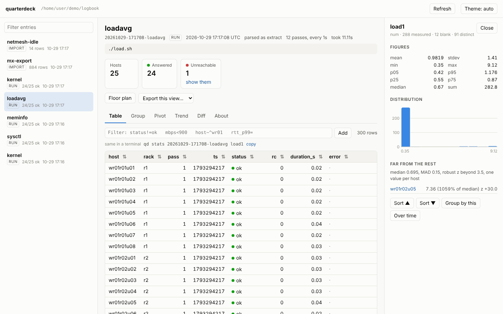
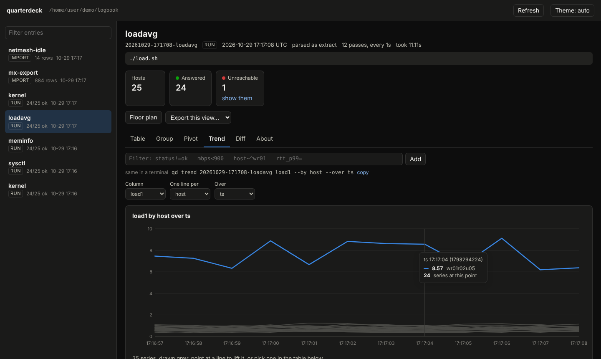
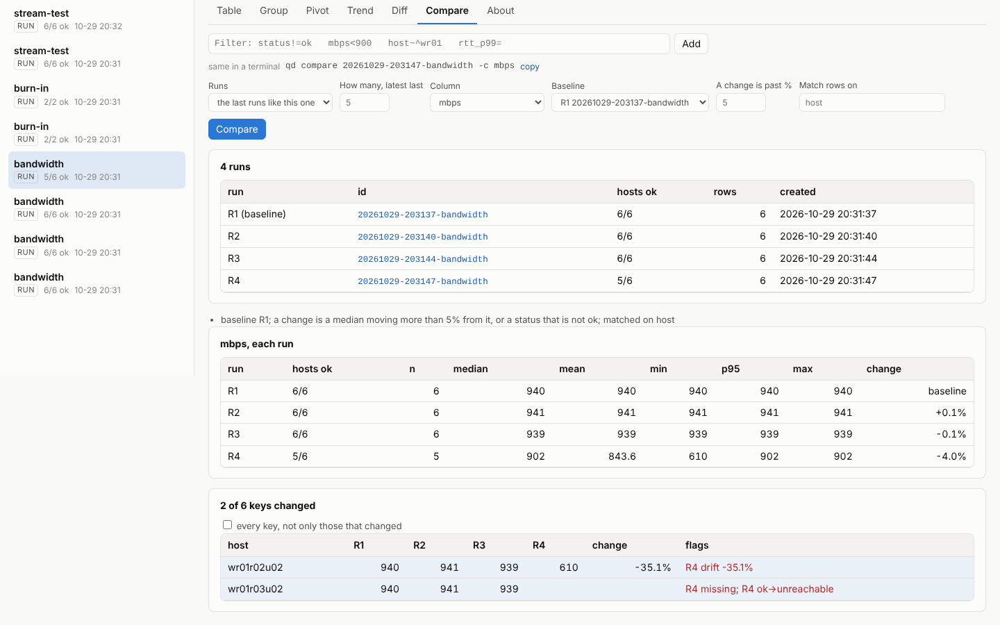

<!--
SPDX-License-Identifier: GPL-3.0-or-later
SPDX-FileCopyrightText: 2026 Martin J. Gallagher
-->

# quarterdeck (`qd`)

[](https://github.com/MartinGallagher-code/quarterdeck/actions/workflows/ci.yml)
[](https://www.gnu.org/licenses/gpl-3.0.html)
[](https://api.reuse.software/info/github.com/MartinGallagher-code/quarterdeck)

The quarterdeck is where a ship is commanded from: the binnacle's
instruments are read there and the log is kept there. This one does that
for a fleet of Linux boxes:

1. **Runs a command on every host and keeps every answer as a dataset.**
   It doesn't just show you N screens of output: each host is a row,
   whatever it printed is parsed into columns by
   [provost](https://github.com/MartinGallagher-code/provost), which keeps
   it, and a host that didn't answer is a row too.
2. **Asks by name.** `qd probe facts` is two hundred readings per host
   from binnacle's why-slow; `qd probe health` is dcprobe's scan;
   `sysctl`, `gpu`, `services`, `mounts` and the rest cover what no
   instrument measures yet.
3. **Drives the rest of the toolchain and keeps what it leaves.**
   [binnacle](https://github.com/MartinGallagher-code/binnacle),
   [matrix_orchestrator](https://github.com/MartinGallagher-code/matrix_orchestrator) (`mx`),
   [iperf_orchestrator](https://github.com/MartinGallagher-code/iperf_orchestrator) and
   [datacenter_visualization](https://github.com/MartinGallagher-code/datacenter_visualization)
   (`dcprobe`, the floor plan) all write files. `qd do` runs one and files
   its output in the same store, in the same shape.
4. **Runs a system in parts, and runs experiments.** `qd split` cuts a
   host list by rack, into shards, waves, random or stratified groups,
   A/B halves or pairs; `qd campaign` works through the parts with
   binnacle's `muster` keeping count; `qd doe` measures a designed
   experiment from design_of_experiments' `doe` and hands the results
   back to it for the analysis.
5. **Reads any of it back, any way you like.** Statistics, value counts
   (who agrees and who doesn't), histograms, robust outliers, group-bys,
   pivots, trends, diffs between two runs and comparisons of many. You can
   read them as text, as CSV/JSON, in a full-screen terminal explorer, in
   a browser, painted on the floor plan, or as an evidence package for a
   test report (`qd report`).

```bash
pip install 'quarterdeck[all]'           # qd, with provost (the store) and binnacle (the instruments)
pip install quarterdeck                  # or qd alone: it finds provost and binnacle on PATH
pip install doehelper                    # for qd doe (Python 3.10+)
```

Or from a clone, which needs nothing installed but provost:

```bash
git clone https://github.com/MartinGallagher-code/quarterdeck
pip install provost binnacle             # the store, and the instruments
./quarterdeck/qd hints                   # runs from the clone
pip install ./quarterdeck                # or put qd (and quarterdeck) on PATH
```

qd itself is Python 3.6+, standard library only. It needs provost to keep
anything (`--no-store` runs without it); binnacle gives it its probes'
instruments and campaigns' muster, and `doe` its designs, each found on
`PATH` or where `QD_<TOOL>` points. Nothing is installed on the fleet and
nothing is left running there. All it needs is key-based ssh, which the
rest of the toolchain needs anyway.

---

## Thirty seconds

```bash
printf '%s\n' 'node[01-24] rack=r1' 'node[25-48] rack=r2' > hosts.txt

qd run -- uname -r                       # every host, every answer, kept
qd freq latest A                         # who runs which kernel
qd probe facts                           # why-slow's readings, a column each
qd stats facts cpu.busy_pct --by rack    # centre and spread, per rack
qd outliers facts mem.available_pct      # who is far from everybody else
qd compare facts -c cpu.busy_pct --last 5    # the last five runs, host by host
qd web                                   # all of it, in a browser
```

```text
qd run -- uname -r: 48 hosts, 46 ok, 2 unreachable   [provost: uname: A]
  stored   20261029-142233-uname in ~/.provost  (48 rows, 46 captures c0001..c0046)

  DID NOT ANSWER
    node09  unreachable      ssh: connect to host node09 port 22: Connection timed out
    node31  unreachable      ssh: connect to host node31 port 22: Connection timed out

  host    A
  node01  6.1.0-18-amd64
  ...

  WHAT TO DO NEXT
    * qd show latest --where status!=ok  the 2 hosts that did not answer, with why
    * reachable hosts.txt -i             binnacle: comment dead entries out of the list
    * qd freq latest A                   2 different answers: who said which
    * provost source 1                   one host's answer exactly as it came back
    * qd view latest                     explore it full-screen
```

---

## What it keeps: provost's store

qd keeps nothing of its own. What comes back is filed by
[provost](https://github.com/MartinGallagher-code/provost), which turns
command output into data and keeps it in git: every host's answer is a
**capture** of its own (`provost source N` shows it exactly as it came
back), opening with a `#%` line that says which run and which host it is.
Where provost has `batch`, a whole run is one commit, the answers parsed in
parallel, and `--context-columns` puts the host (and its rack, and the
run) on every row, so `provost show NAME` says who said what without qd.
An older provost files one capture at a time, one after another, and qd
puts the host back from each capture's prologue just the same.

Besides the answers, a run files two tables of qd's own:

| Dataset | One row per | What |
|---|---|---|
| `qd.runs` | run | what ran, where, when, how many hosts answered |
| `qd.hosts` | host and pass | status, rc, duration, stderr, whether it printed anything |

and qd puts them back together when you read a run: each host's status
beside the rows provost parsed out of its answer, and a row for a host
that printed nothing. Whichever store it is, `provost ls` there lists what
qd filed.

### Who ran it

Every run says who ran it and from where, so a fan-out is attributable
after the fact. `qd log RUN` shows it, `qd log` lists the operator beside
each run, and `qd web` puts it in the run's header.

| `qd.runs` column | What | Recorded by |
|---|---|---|
| `operator` | `QD_OPERATOR`, else your login user | every run |
| `operator_host` | the machine qd ran on | every run |
| `ssh_user` | `--user`, else what your ssh config gives each host (`ssh -G`); hosts with users of their own give each, comma-separated | a fan-out |
| `ssh_key` | the fingerprint of each key qd offered: the `-i` keys (or `IdentityFile`) in `--ssh`, else your agent's (`ssh-add -l`). Never the key itself | a fan-out |
| `sudo` | `yes` or `no` | a fan-out |
| `via` | how the hosts were reached: `ssh`, `srun`, `pdsh` or `clush` | a fan-out |
| `sched_job` | the Slurm job `--via srun` ran in (each answer carries it as `sched.job`) | `--via srun` |

Anything qd cannot find out is blank, never a guess: an ssh without `-G`
(older than OpenSSH 6.8, or a wrapper), no `ssh-add` or an empty agent,
or a key file `ssh-keygen` cannot read. Which of several offered keys a
host accepted is not known without connecting, so `ssh_key` lists every
one offered. With `--via` other than ssh, `ssh_user` is the `--user`
given (pdsh's and clush's `-l`) or blank, and `ssh_key` is blank: their
ssh is configured apart from qd's. Runs filed before 0.8.2 have none of
these columns, and runs before 0.11.0 no `via` or `sched_job`; they show
blank. qd also passes the operator to provost as `PROVOST_OPERATOR` (unless
you set it yourself), for a provost that records it (PV-027); provost
2.3.0 does not yet.

### Named stores: `qd store`

```bash
qd store new lab               # ~/.local/share/quarterdeck/stores/lab
qd store new bench --path /data/bench
qd store use lab               # the store commands use from now on
qd store ls                    # every store, its runs, which is active
qd run -s hosts.txt --store bench -- uptime
qd store rename lab lab-2026   # a store qd made moves with its name
qd store rm bench              # forgotten; --delete deletes its files too
qd store clear lab --yes       # empty it: every run and dataset goes
```

Which store a command uses, the first of these that applies:

1. `--store NAME` or `--store DIR`: a store's name, or a directory as
   before, so existing scripts keep working.
2. `QD_STORE`: a name or a directory.
3. provost's own explicit choice: `PROVOST_WORKSPACE`, or the controlled
   directory you are in (`provost control`). qd and provost never disagree
   about where you are.
4. The active store: `qd store use NAME`, kept in
   `~/.config/quarterdeck/config.json`.
5. provost's default, `PROVOST_HOME` or `~/.provost`, with a warning that
   no store is active.

Once provost's default store exists, qd registers it as `default`, and
makes it the active store if none is. So a machine that used qd before
stores had names keeps working without a step. `qd log`, `show`, `view`,
`compare`, `diff`, `stats` and the rest all read the store chosen this way.
`qd web` has a picker for the named stores.

**Moving a store between machines**:

```bash
qd store export lab lab.tgz    # NAME is optional: the store in use
qd store import lab.tgz --as lab-from-rig2
```

An export is one archive: the store whole, with its git history and every
raw answer under `captures/`. First comes a manifest: qd's and provost's
versions, the store format, the run count and a sha256 for every file. The
export takes provost's own store lock, so it refuses while a run is filing,
and no run starts filing until the archive is written. (A run that finishes
during a long export waits up to provost's lock timeout, 30 s.)

An import checks the manifest, every checksum, that nothing is missing or
added, and that this qd reads the store format. It refuses a member that
would land outside the store, and a link or a device. Only then is the
store given its name. It refuses a name that is taken: it never merges
into an existing store.

**A store on another machine**:

```bash
qd store new wr01 --remote wr01:~/.provost     # [USER@]HOST:PATH, as scp takes it
qd web --store wr01                            # or log, show, view, compare, diff
qd log --store wr01 --no-fetch                 # the copy as it is, offline
```

A remote store is read from a copy here, in
`~/.cache/quarterdeck/remotes/NAME`. The copy is shallow: it holds the
store as it is now, with no history, and no read needs history. `qd store
new` makes the copy at once, so a store that cannot be reached is reported
straight away.

- **Fetching:** before a command reads the store, qd fetches what is new
  over the same ssh `qd run` uses (`QD_SSH`, `QD_SSH_USER` unless the spec
  names a user, your keys, your jump hosts),
  at most once every `QD_REMOTE_REFRESH` seconds (30). `qd web` fetches the
  same way while the page is open, so new runs show without a restart, and
  its store picker lists the remote store with its host.
- **An unreachable host:** qd reads the last copy and says how old it is.
  It does not try that host again until `QD_REMOTE_REFRESH` has passed.
- **Writing is refused:** nothing files into a copy, because the copy would
  then differ from the store. `qd run`, `do`, `import`, `probe`, `rm`,
  `store clear`, and a campaign's or design's runs are refused before they
  contact a host, with the `ssh HOST qd ...` that does it where the store
  is.
- **Another user's store:** if the store belongs to another user on that
  machine, git refuses to read it. qd says so, with the `git config
  --global --add safe.directory PATH` to run there.
- **Renaming and removing:** `qd store rename` moves the copy with the
  name. `qd store rm` deletes the copy and leaves the store on the other
  machine as it was.

Name a run the way you'd say it:

| Reference | Means |
|---|---|
| `latest`, `latest~1`, `prev` | the newest run, the one before it |
| `20261029-142233-uname` | that run; any unique part of an id works too |
| `kernel` | the newest run named `kernel` (`--name`, a probe's name) |
| `latest:hosts` | one table of a run: `data` (the default), `hosts` |
| `ds:uname` | a whole provost dataset: every run that ever filed into it |
| `results.tsv`, `reports/` | a file or directory, read without filing it |
| `kernel@wr02`, `latest:hosts@wr01` | any of the above, read in the registered store `wr02` |

`qd log` lists the runs and `qd log RUN` describes one.

**Runs from different stores side by side**: add `@STORE` to a reference
and it is read in that registered store, whatever `--store` says, so two
labs' or two machines' runs are compared without exporting one store into
the other:

```bash
qd diff kernel@wr01 kernel@wr02          # the same probe, two machines' stores
qd diff kernel@wr01                      # against the run before it in wr01
qd compare facts@lab facts@bench -c cpu.busy_pct
qd compare facts --last 5@lab            # five runs, all of them lab's
qd show latest:hosts@wr01
qd view latest@wr02
```

- **Which commands:** every one that reads a run -- `show`, `stats`,
  `freq`, `hist`, `outliers`, `pivot`, `trend`, `export`, `floor`, `log
  RUN`, `diff`, `compare`, `view` -- and the Diff and Compare tabs of `qd
  web`. Commands that file or delete (`run`, `do`, `import`, `probe`, `rm`,
  ...) take no `@STORE`: they use `--store`, as before.
- **Only a registered name** (`qd store ls`), never a directory: a
  directory is `--store`'s job. A name that is not registered is an error
  that lists the stores, never a quiet fallback to `--store`. A file or
  directory whose name has an `@` in it is still read as a file.
- **Where it splits:** on the last `@`, which is in no run id or provost
  dataset name. A table goes before it: `latest:hosts@wr01`.
- **Remote stores** are read like any other: the copy is fetched as
  `--store` would fetch it, and once per command however many references
  name that store.
- **Reports say where each side came from:** a run from a store other
  than the command's own is shown as `RUN@STORE` in report headers and in
  `compare`'s list of runs, since the same run id can be in two stores.
  Paste it back and it reads the same run.
- **Different fleets:** `compare` matches hosts by name, so a host one
  store measured and the other did not is blank on the other side (not
  measured), never zero.

**Deleting**:

```bash
qd rm latest~1                 # says what would go, and deletes nothing
qd rm latest~1 kernel --yes    # those runs: answers, tables, their rows
qd rm ds:loose --yes           # a whole dataset, every run's rows in it
qd store clear lab --yes       # everything in the store
```

`qd rm` and `qd store clear` first list what would go, and delete nothing
without `--yes`. Then provost deletes it, as one commit, so the store's git
history keeps what was there. A run goes whole: every host's answer and
every table it filed, from whichever datasets they are in (other runs'
rows in those datasets stay), and its rows in `qd.runs` and `qd.hosts`.
qd's own records (`qd.runs`, `qd.hosts`, `qd.campaigns`, `qd.designs`,
`qd.peers`, `qd.baselines`) are never deleted whole by `qd rm`. A run that was part of a campaign is said,
with the `qd campaign retry` that runs that part again.

Deleting one run needs `provost rm --capture`, which is newer than provost
2.2.0. An older provost is refused with that reason, and the store is left
as it was. `qd store clear` and `qd rm ds:NAME` work with any provost.
`qd store clear` keeps the history; for a store with none, `qd store rm
NAME --delete` and then `qd store new NAME`.

---

## Running commands on many hosts: `qd run`

```bash
qd run --servers hosts.txt -- 'sysctl net.core.somaxconn'
qd run -S 'node[01-24]' -- uptime
qd run --layout floor.dc --select 'rack[1-3]' -- cat /proc/loadavg
```

### Host lists

Host lists use the grammar mx, iperf_orchestrator, agree and dcprobe
already read: one `name[=addr[:port]]` per line, `#` comments, and ranges
that expand (`node[01-24]`, `rack[a-c]-n[1,3]`). `hosts.txt` or
`servers.txt` in the current directory is used if you name none.

`key=value` words after a host are its **attributes**, as dcprobe reads
them:

```text
wr01r01u01=10.1.1.11 rack=r01 row=A gbps=25
wr01r01u02=10.1.1.12 rack=r01 row=A gbps=25
```

Attributes become columns in every dataset. That's what lets you write
`qd stats latest load1 --by rack` without joining two files.

> agree, mx and iperf_orchestrator don't have attributes. agree reads
> `node01 rack=r1` as *two hosts*. Give those tools the plain list:
> `qd hosts --plain > servers.txt`. In the other direction, a host that
> carries `=` goes on a line of its own: `a=10.0.0.1 b=10.0.0.2` on one
> line is a host with an attribute here, and qd warns when it sees that.

`--layout floor.dc --select SEL` asks binnacle's
[`manifest`](https://binnacle.readthedocs.io/en/latest/tools/manifest.html)
which servers a `.dc` layout puts under the selectors (`rack[1-3]`,
`row[A,C]`, `+gpu`, `model=hgx*`). Where each one sits (room, row,
rack, slot) comes back as attributes. `qd hosts` prints any of this
without running anything.

### Reaching the hosts: ssh, srun, pdsh or clush

ssh is the default: one connection per host, `--jobs` at a time. Where a
test event reaches its nodes some other way, `--via` (`QD_VIA`) changes
how the hosts are reached and nothing about what is kept: every host is
still a row, a host that did not answer is a row too, and the outcomes,
`--push`, `--script`, `--sudo`, `--every` and the cleanup are the same.

```bash
salloc -N 64 -p gpu                        # or inside an sbatch script
qd run --via srun -- nvidia-smi -L         # every node of the allocation
qd run --via pdsh -s hosts.txt -- uptime   # one pdsh for all of them
QD_VIA=clush qd probe inventory -s 'node[01-64]'
```

| `--via` | How | Pushed files and stdin |
|---|---|---|
| `ssh` | one `ssh` per host (`--ssh`, `--scp`) | `scp` |
| `srun` | inside a Slurm allocation: one step per host, `srun --overlap -N1 -n1 -w NODE sh -c CMD` | through the step's own stdin, a step per file |
| `pdsh` | one `pdsh -w a,b,c -f JOBS` for every host | `pdcp` (which must be on the hosts too) |
| `clush` | one `clush -w a,b,c -f JOBS` for every host | `clush --copy` |

**srun.** qd runs only inside an allocation it is given (`salloc`,
`sbatch`, or `SLURM_JOB_ID` set to one of yours); it never asks Slurm for
one. With no hosts named, the fleet is the allocation's nodes, as
`scontrol show hostnames $SLURM_JOB_NODELIST` lists them, even if there
is a `hosts.txt` in the directory; `-s` or `-S` names a subset.
`--overlap` lets each step run beside the job's own. Every answer's `#%`
prologue carries the job as `sched.job` (provost's run-manifest key,
PV-020) and the partition as `sched.partition`: columns of every row in
the dataset (`qd show ds:NAME`) with a provost that has `batch`, and in
each capture's context (`provost source`) with any. The run's `qd.runs`
row says `via=srun` and the job. A node srun could not start a step on
is `unreachable` with srun's reason. srun runs as you (`--user` is not
used) and in the directory qd was started from, as srun does. A command
that times out is stopped with SIGTERM, which ends its step.

**pdsh and clush.** One call answers for every host: pdsh (or clush) puts
`host: ` before each line, which tells the answers apart, and qd adds a
line after the command with its exit status, which pdsh does not report
per host. A host with no such line did not answer. `--jobs` is the
fan-out (`-f`), `--timeout` each host's limit (`-u`), and `--user` its
`-l`. pdsh's ssh gets the options qd's own ssh uses (`BatchMode=yes`,
`StrictHostKeyChecking=accept-new`) after any you set in
`PDSH_SSH_ARGS_APPEND`; which remote shell it uses is pdsh's own setting
(`PDSH_RCMD_TYPE`). Some limits:

- A host is reached by name: no port per host (put it in your ssh
  config), and two hosts at one address are refused.
- A command's stdin (the script probes send binnacle's scripts on it) is
  pushed as a file beside the command and read from there, since pdsh
  forwards none (clush is treated the same way).
- `--rate` spaces hosts out, which one call cannot: with it, each host is
  a call of its own.
- Some pdsh builds merge a host's stderr into its stdout, or cut very long
  lines; qd keeps what pdsh gives it.

The probes that are tools driving the fleet themselves (`health`,
`preflight`, `reach`) still reach it over ssh, and say so. `qd doctor
--via srun` (or pdsh, clush) checks the launcher: found here, and for
srun, the allocation qd is in.

### What comes back

provost reads each host's answer: CSV and TSV, JSON, `key: value` and
`key = value` lines, aligned tables like `df -P` and `ss`, a lone number,
and two hundred tool-specific formats besides. A provost that has `batch`
also reads the floor-plan viewer's results format (`!test` lines over
`test target value` samples) and JSON Lines under `#` comment lines, keeps
quotes inside TSV cells, and reads nested JSON the same with or without
`jq`; PyPI's 2.1.0 drops those quotes, and nested JSON keys where there is
no `jq`. `MemTotal: 16384 kB` stays
`16384 kB`, and qd reads it as the number 16384 in kB; sizes in mixed
units (`512M` beside `50G`) are put on one scale before any statistic. A
host whose answer provost could not read as a table is held in its
`unsorted` bucket (`provost triage` says why) and its row says so. Every
host's answer is kept, exactly, either way.

Every dataset a run makes has these columns: `host`, its attributes,
`status` (`ok`, `failed`, `timeout`, `unreachable`, `push-failed`, in
agree's sense of each), `rc`, `duration_s`, `error` (the first line of what
went wrong) and `capture` (provost's id for the answer), then what provost
read.

### Over time

```bash
qd run --every 10 --count 30 -- 'cut -d" " -f1 /proc/loadavg'
qd trend latest A                        # a sparkline per host
```

`--every S --count N` runs N passes, one starting every S seconds, into a
single dataset with `pass` and `ts` columns. `--count 0` runs until
Ctrl-C, and every pass that finished is kept.

### Scripts, sudo, and safety

| Flag | |
|---|---|
| `--script FILE -- ARGS` | push FILE, run it with ARGS, remove it again |
| `--push FILE` | copy a file over first (repeatable); the command runs beside it, in a directory of the run's own in `--remote-dir` |
| `--sudo` | run under `sudo -n` |
| `--dry-run` | print the ssh (or srun) command per host, or the one pdsh or clush call; contact nothing |
| `--first N` | the first N hosts only, the canary before the fleet |
| `--limit N` | refuse to run wider than N hosts without `--yes` |
| `--no-store` | print the answers, keep nothing |

The mutation guard is agree's: `rm -rf`, `mkfs`, `reboot`, `systemctl
stop` and the rest are refused without `--yes`. It's a typo guard, not
security.

**qd deletes only what it made.** A run that pushes makes a directory of
its own, `qd.<run id>`, in `--remote-dir`, and writes `.qd-owned` into it
with that id. Afterwards it removes that directory, and `--remote-dir`
only if this run made it and it is empty. The checks run on the host,
under the same `sudo -n` as the delete: the path must end in exactly this
run's `qd.<run id>`, hold no `..`, be a directory and not a symlink, and
hold a `.qd-owned` with this run's id. Otherwise nothing is deleted, and
the host's `error` says `qd: refusing to remove` and why.
`--keep-remote` leaves the directory, mark and all.
`tests/test_cleanup.sh` holds qd to this.

### Allow-lists and read-only

The mutation guard says what may *not* run, and no such list is ever
complete. For a system under test that must not be changed, say what
*may*:

```bash
cat allow.txt
# what may run on the system under test
uname *
cat /proc/*
nvidia-smi --query-gpu=* --format=csv

qd run --allow allow.txt -s hosts.txt -- uname -r       # runs
qd run --allow allow.txt -s hosts.txt -- echo hi        # refused
qd run --allow allow.txt --confirm -s hosts.txt -- echo hi   # asks: type CONFIRM
qd probe facts inventory --read-only -s hosts.txt       # probes still run
```

- **`--allow FILE`** (`QD_ALLOW`): one pattern a line, `#` for comments.
  A pattern matches the whole command as it would be sent (spaces
  collapsed), with `*` for anything and `?` for one character, so
  `uname *` does not allow `uname -r; reboot`. A command no pattern
  matches is refused, with exit 2, unless `--confirm` is given *and*
  someone at the terminal types `CONFIRM`; with nothing attached to the
  terminal it is refused outright. The probes qd ships run by name.
- **`--read-only`** (`QD_READ_ONLY=1`): only the probes and allow-listed
  commands run, and no confirmation lifts it. `--push`, `--script` and
  `--sudo` are refused, and so is `qd do`, whose tools deploy agents and
  servers to the hosts.
- **On record:** every run under a policy says so in its notes (`qd log
  RUN`): read-only, the allow-list's name and the first 12 hex digits of
  its sha256, and any command confirmed outside it, with who confirmed.
  A refusal files no run, so each one is appended to `policy.log` in
  qd's cache (`~/.cache/quarterdeck/`): time, operator, verb, command and
  reason, tab-separated.
- The mutation guard still applies on top: an allow-list that names
  `rm *` does not let `rm -rf` past it without `--yes`.

**This is policy, not a sandbox.** An allow-listed shell, a script the
hosts already hold, or a quoting trick gets past any list of patterns.
It stops the mistakes and the out-of-scope commands; the real control is
the account's own ssh and sudo rights on the hosts.

### Every knob has a flag and a variable

| Flag | Variable | Default |
|---|---|---|
| `--servers` | `QD_SERVERS` | `hosts.txt` or `servers.txt` |
| `--via` | `QD_VIA` | `ssh`; or `srun`, `pdsh`, `clush` (see Reaching the hosts) |
| `--user` | `QD_SSH_USER` | your ssh config |
| `--jobs` | `QD_JOBS` | 32 hosts at once |
| `--timeout` | `QD_TIMEOUT` | 60 s per host |
| `--max-output` | `QD_MAX_OUTPUT` | 4 MiB per host; past it the host is killed and reported |
| `--ssh`, `--scp` | `QD_SSH`, `QD_SCP` | `ssh`, `scp` |
| `--remote-dir` | `QD_REMOTE_DIR` | `/var/tmp` |
| `--rate` | `QD_RATE` | none: new connections as fast as `--jobs` allows; `10/s` for a bastion's `MaxStartups` |
| `--allow` | `QD_ALLOW` | none: every command may run |
| `--read-only` | `QD_READ_ONLY=1` | off |
| | `QD_OPERATOR` | your login user: who a run says ran it (see Who ran it) |
| `--store` | `QD_STORE` | a name from `qd store ls` or a directory; else the active store (see Named stores) |
| | `QD_PROVOST` | `provost` on `PATH` |
| | `QD_PROVOST_BATCH=0` | file one capture at a time even where provost has `batch` |
| | `QD_FILE_JOBS` | one capture at a time: one provost after another. N files N at once, but only where `mkdir --version` is not uutils coreutils' before 0.11.0 (Ubuntu 25.10 and 26.04): there two can share provost's lock and lose a capture. With `batch`: its `-j` |
| | `QD_FILE_CHUNK` | 200 inputs per `provost batch`, each a commit, so its lock is never held for a whole big fleet |

Exit status is 0 when every host answered, 1 when one didn't, and 2 for a
usage error.

---

## Asking by name: `qd probe`

```bash
qd probe                                  # the catalogue, and what's installed here
qd probe facts inventory -s hosts.txt     # each probe is a run of its own name
qd show facts --cols host,cpu.busy_pct,mem.available_pct
```

| Probe | Kind | What |
|---|---|---|
| `facts` | binnacle, on each host | why-slow `--facts`: cpu.\*, mem.\*, disk.\*, net.\*, fs.\*, lim.\*, cg.\*, therm.\* |
| `why-slow` | binnacle, on each host | why-slow's findings: rule, severity, detail, fix |
| `skew` | binnacle, on each host | clock and time sync |
| `health` | dcprobe, from here | load, CPU, iowait, steal, memory, swap, disk, NIC link and drops, kernel errors, inventory |
| `preflight` | dcprobe, from here | ssh, skew, nofile, bind, tools: before a test |
| `reach` | binnacle, from here | `reachable --csv`: ping and ssh, and why not |
| `os`, `sysctl`, `services`, `gpu`, `mounts`, `disks`, `packages`, `numa`, `pagecache`, `listen`, `containers` | a shell command | what none of the instruments measures |

Groups: `inventory` (os, disks, mounts, numa, gpu, packages), `settings`
(sysctl, numa), `state` (services, listen, containers, pagecache). A
binnacle tool is sent to `python3 -` on each host over ssh's stdin, as
why-slow's own `--ssh` sends itself: one connection per host, nothing
copied there and nothing left behind. The hosts need python3, and binnacle
needs to be installed here, nowhere else. A probe whose tool isn't here
says what to install before it contacts a host.

The probes you name run together. Every host is asked every probe at once,
`--jobs` at a time in all. Every run is then filed by one provost call, in
one commit, and each is still a run of its own name. Asked one after
another, each probe paid its own round of ssh, its own 8 s wait on a host
that is down, and its own provost call. On six hosts, `qd probe facts
inventory` went from 41 s to 26 s. The tools that drive the fleet from here
(`health`, `preflight`, `reach`) run after them, one at a time. With
`--every` or `--count`, the probes run one after another as before.

The shell probes are POSIX sh, run the same under bash, dash and busybox
ash, and read `/proc` and `/sys` where a command might be missing (`disks`
from `/sys/block`, sizes in bytes; `mounts` from `/proc/self/mounts`). A
host without what a probe asks says so (`listen_tool: none`, `system_state:
no systemd`, `nvidia_smi: absent`), and a value it could not read is left
out: blank, never 0 or "unknown". They were run against Debian 12, Ubuntu
24.04, Rocky 9 and Alpine 3.20 over real ssh.

---

## Cutting a host list: `qd split`

```bash
qd split -s hosts.txt --by rack --out lists/     # lists/rack-r1.txt, rack-r2.txt, ...
qd run -s lists/rack-r1.txt -- ...
```

The lists keep each host's attributes, so qd and dcprobe read them as
they were. `--plain` writes names only, for agree, mx and
iperf_orchestrator, which would read `rack=r1` as a host.

| Flag | Lists |
|---|---|
| `--by ATTR` | one per value of an attribute (with `--layout`, the manifest's room, row, rack, slot) |
| `--into N` / `--deal N` | N shards in list order / dealt round-robin |
| `--size N` | waves of N, in list order |
| `--random N --seed S` | N groups at random; `--stratify rack` spreads every rack across them |
| `--ab` | two halves for an A/B comparison, stratified by rack when there is one |
| `--canary N` | the first N, then the rest |
| `--pairs`, `--pairs --ring` | two by two, or each host with the next all the way round |
| `--reachable` | up and down, as binnacle's `reachable` finds them |
| `--answers RUN` | by what each host said in a stored run: identical answers together, the way agree groups a fleet |

Every list keeps its hosts' attributes and is a host file the whole suite
reads. `--format csv` gives `group,host,...` instead.

---

## A system in parts: `qd campaign`

```bash
qd campaign new burnin -s hosts.txt --by rack -- ./burnin.sh --minutes 30
qd campaign run burnin              # every rack in turn; Ctrl-C and come back later
qd campaign run burnin --parts 2    # or two racks now
qd campaign status burnin           # PROGRESS 5 of 12 parts done, and how each went
qd campaign retry burnin            # the racks that had a host fail, back in the pool
qd compare --group burnin -c temp_c # the racks side by side
```

A campaign is a command and a host list cut into parts, any way `qd split`
cuts one. Which parts are done is binnacle's
[`muster`](https://binnacle.readthedocs.io/en/latest/tools/muster.html) to
keep: its pool hands each part out once, under a lease, so a second
terminal running the same campaign takes the next rack rather than the
same one, and a part whose worker died comes back when its lease runs out.
`muster status --pool ...` reads the same progress. What each part found is
provost's: a part is a run named after the campaign, its campaign and part
on every row. The definition is filed too (`qd.campaigns`), and the pool
can live anywhere every worker can read (`--pool`).

### Pacing: power domains, a ramp, maintenance windows

A burn-in that loads every node on one PDU at once can trip its breaker.
`campaign new` keeps three limits with the campaign, so every `campaign
run` -- resumed, or carried on from another machine -- paces the same:

```bash
qd campaign new burnin -s hosts.txt --by rack --max-per pdu=4 \
    --ramp 6/min --window "Mon-Fri 18:00-06:00" --window "Sat,Sun 00:00-24:00" \
    -- ./burnin.sh --minutes 30
qd campaign status burnin   # at most 4 per pdu; ramp 6/min; windows ... (closed; the next opens Mon 18:00)
```

- **`--max-per ATTR=N`** (repeatable, or `pdu=4,rack=8`): no more than N
  hosts sharing a value of ATTR run at once. ATTR is any host attribute
  in the host list (`node07 pdu=p3 rack=r2`), the same ones `--by` reads.
  Hosts without it share one count rather than going unlimited. Other
  values go past a full one, so a cap holds a PDU back without holding
  the fleet back.
- **`--ramp RATE`** (`6/min`, `1/s`, `120/h`): host starts are spaced
  evenly, so the draw rises in steps. The spacing carries on from one
  part to the next.
- **`--window SPEC`** (repeatable, `;` between several): `[DAYS]
  HH:MM-HH:MM` in local time, days as `Mon-Fri` or `Sat,Sun`, a span past
  midnight belonging to the day it starts (`Fri 18:00-06:00` runs into
  Saturday morning), no days for every day. `campaign run` starts a part
  only inside a window; outside one it starts nothing, says when the next
  opens, and exits 0. A part already running finishes.
- Flags given to `campaign run` override the kept ones for that run.

The caps and the ramp hold within one worker. Two terminals running one
campaign each keep their own count; muster still gives them different
parts.

Two workers filing into one store at the same moment rely on provost's
store lock, and that lock is `mkdir`. Where `mkdir --version` says uutils
coreutils before 0.11.0 (the default on Ubuntu 25.10 and 26.04), two
provost processes can both take it, and a part's answers can be lost. On
such a machine, run one worker per store, or switch the machine to GNU's
`mkdir` (Ubuntu's `coreutils-from-gnu`).

---

## Many runs side by side: `qd compare`

```bash
qd compare facts -c cpu.busy_pct --last 5        # the last five runs of facts
qd compare monday tuesday latest -c mbps         # these three
qd compare --group burnin -c temp_c              # a campaign's parts, a design's points
qd compare kernel --last 10                      # no column: every numeric median
```

One row per run (hosts that answered, n, median, mean, min, p95, max, and
the change from the baseline), then host by host every run's value side by
side, flagged where a median moved more than `--drift` percent (5) from the
baseline or the host's status was not ok. The baseline is the first run, or
`--baseline RUN`, or a qualified baseline's name (`--baseline NAME`, next
section), which adds a significance test. `--peers NAME` with `-c` adds a
row per peer group: its median in each run, flagged where it moved past
`--drift`; `--format csv` is then that table. Runs over different hosts (a
campaign's parts) are compared as wholes. With no column, every numeric column the runs share is
compared by its median, leaving out what the runs *were* rather than what
they measured: a design's factors and the hosts' attributes. `--format csv`
is the host-by-run table. The exit status is 1 when anything changed, as
with `diff`. `qd web` shows the same comparison on its Compare tab. Runs
from other stores go in as `RUN@STORE` (see *Runs from different stores
side by side*); `--last N@STORE` takes the last N from that store.

---

## Peer groups and qualified baselines: `qd peers`, `qd baseline`

A drift threshold says a host moved 5%. It cannot say whether 3% is a
real slide or a run that happened to be slow, and it says nothing until
the 5% is crossed. Two things kept in the store answer that: **peer
groups**, the hosts that ought to measure alike, and **qualified
baselines**, what those groups measured on runs someone vouched for.

```bash
qd peers define sku --by sku                     # a row's group is its sku column
qd peers define pods --from pods.tsv             # host and group, from a file
qd peers define hw --facts kernel,bios           # each host's kernel and BIOS, from the latest facts run
qd peers ls                                      # qd peers show NAME [RUN], qd peers rm NAME --yes

qd stats latest mbps --peers sku                 # centre and spread, group by group
qd outliers latest mbps --peers sku              # each host against its own peers

qd baseline set gold iperf --last 5 --peers sku -c mbps --note "after the BIOS update"
qd baseline show gold                            # what it holds, run by run; qd baseline ls, rm
qd compare iperf --last 5 --baseline gold        # later runs against it
```

**A peer group** is one of two kinds. `--by COLS` is a rule: a row's group
is its value of those columns (a host attribute like `rack` or `sku`, which
qd puts on every row), in whatever is read. `--from FILE` (a `host` and a
`group` column, or two words a line) and `--facts COLS` are lists, frozen
when defined: `--facts kernel,bios` reads each host's values from the
latest `facts` run (`--run RUN` reads another), so the groups are what the
hosts actually are, and a later facts run moves nobody until the group is
defined again. A blank in a `by` column, a blank fact, or a host the list
does not name is in no group, and is said to be left out: not measured is
not a group of its own. `--replace` files a new definition over an old
one; the old one stays in the store's history.

`qd stats --peers NAME` groups by the peer group first (before any
`--by`). `qd outliers --peers NAME` holds each host against its own group's
median and spread rather than the fleet's, so a host that is ordinary
fleet-wide but far from its own SKU is found, and one that only looks odd
because its SKU is different is not.

**A qualified baseline** is set from one or more runs (named, `RUN --last
N`, or `--group CAMPAIGN`) and kept as qd's own table, `qd.baselines`:
who set it (the operator, as on a run) and when, the note, the runs, and,
for each column, peer group and host, the value every run gave, with their
median, spread (MAD) and count. It is not "the first run in the list": a
bad run cannot become the baseline by being first, and who blessed it is on
record. A name that is a run's is refused, so `--baseline NAME` is never
ambiguous; `--replace` sets it again.

Each run is reduced the way `compare` reduces one (a host's rows to their
median, `--agg`), and a peer group to the median of its hosts, so the
group has one value per run and the runs are the replicates.
`qd compare ... --baseline NAME` then gives, per column and peer group:

| Figure | What |
|---|---|
| `drift_pct` | the runs' median against the baseline's, in percent |
| `effect` | the rank-biserial correlation, −1 to +1: +1 when every run is above every baseline run |
| `p` | the Mann–Whitney U test, two-sided: exact for 8 runs or fewer with no ties, else the normal approximation with the tie and continuity corrections (scipy's `mannwhitneyu` figures) |
| `p_holm` | `p` adjusted by Holm's method for the number of tests in the comparison (columns × peer groups), so many groups do not multiply false alarms |
| `verdict` | significant (`p_holm` below `--alpha`, 0.05), not significant, too few runs, not measured |

A significant difference is a change even inside `--drift`: that is the
point, a slide seen before a fixed limit is crossed. It has to be at least
`--min-drift` percent (1, `QD_MIN_DRIFT`), because runs with no noise at
all make any difference a sure one, and 0.03% is not a slide anyone acts
on: smaller, the verdict says "significant (under 1%)" and nothing is
flagged. A median past `--drift` is still a change whatever the test
says. The test needs **three
runs a side**; with fewer the drift alone is used and the verdict says so.
With exactly three a side the smallest p a rank test can give is 0.1, so
nothing can be significant at 0.05 and the report says that too: four a
side reach 0.029, five 0.008. Host by host, each host's median over the
runs is held against its baseline median by the drift alone (one test per
host would be hundreds of tests on a handful of runs). The runs the
baseline was set from are left out of what is held against it. A blank is
not measured: a run that did not measure a host gives it no value, never a
zero, and a baseline's count is of the runs that measured it. `--format
csv` is the per-group table; the exit status is 1 when anything changed.

The test is qd's, in the standard library: design_of_experiments' `doe`
compares two sessions run by run (a paired t-test, matched by factor
levels), which is not this question, and needs numpy, scipy and Python
3.9 or newer.

---

## Against requirements: `qd check`

`qd compare` and `qd outliers` say what moved and who stands out. `qd
check` says whether a run meets fixed limits, one verdict per
requirement, as a table for a test-readiness review:

```bash
qd check latest --against limits.tsv          # one row per requirement
qd check latest --against limits.tsv --each   # one row per host per requirement
qd check latest --against limits.tsv --keep   # and file the verdicts (qd web, qd export)
qd check latest --against limits.tsv --format csv -o trr.csv
```

The thresholds file is TSV (or CSV) with a header. `req`, `column`, `op`
and `limit` are required; `limit2`, `where`, `agg`, `unit` and `note`
may be left out or blank:

```text
req      column  op       limit  limit2  where      agg   unit
SYS-101  mbps    >=       900            status=ok        Mbps
SYS-102  rtt     <=       250            rack=r2    p99   us
SYS-103  status  in       ok,pass
SYS-104  temp    between  20     45                 max
```

- **`op`**: `<`, `<=`, `>`, `>=`, `==`, `!=`, `in` (a comma list of
  words, without regard to case) or `between` (`limit` to `limit2`,
  inclusive). `==` and `!=` compare numbers as numbers and words as words.
- **`where`** narrows the rows, in `--where`'s grammar. `--where` on the
  command line narrows them for every check.
- **`agg`**: `each` (the default: every row must pass) or one figure over
  the rows -- `mean`, `median`, `min`, `max`, `sum`, `stdev`, `range`,
  `p05`, `p25`, `p75`, `p95`, `p99`.
- **`unit`** is the limit's unit, if the limit does not carry one
  (`250us` does). Sizes and times are put on one scale, so `0.3ms`
  fails `<= 250us` and `2G` passes `<= 4096M`, and the observed value is
  shown in the limit's unit. Units that cannot be compared (a time
  against a rate) are refused, and the check is not measured; a column
  that carries no unit is read in the limit's, and the note says so.

Each check is **pass**, **fail** or **not measured**. Blank is never a
pass: a missing column, no rows left by `where`, or a blank cell is not
measured. Under `each`, one row that failed fails the check; otherwise
one unmeasured row makes it not measured. An aggregate over some hosts
but not all is not measured either, and the note gives the figure it
would have had and who measured nothing. The `measured` column says how
many of the rows did.

The exit status is 0 when every check passed, and 1 when any failed or
was not measured: a finding, as everywhere else in qd. A thresholds
file qd cannot read (a missing column, an unknown `op` or `agg`, a
`between` without `limit2`, a word where a number belongs, the same check
twice) is refused with exit 2, naming the check.

`--keep` files the verdict table in the store as a run of kind `check`,
named `check-<run>`, so `qd show`, `qd export` and `qd web` read it like
any other dataset.

---

## For a test report: `qd report`

The other commands answer one question each. `qd report` puts their
answers for a run, or a whole campaign, into one directory an evaluator
can read, check and attach without qd:

```bash
qd report latest --out evidence/                      # one run
qd report latest --out evidence/ --check limits.tsv --baseline accepted --zip
qd report campaign:burnin --out burnin-evidence/      # every part of a campaign
```

```text
evidence/
  summary.html, summary.md       what to read first: findings, then each section
  manifest.json                  the run records, versions, store head, what was left out
  SHA256SUMS                     every other file:  cd evidence && sha256sum -c SHA256SUMS
  data/RUN/data.csv, data.json   each table, as qd export writes it
  data/RUN/data.stats.csv, .json qd stats on it
  data/RUN/outliers.csv, .json   qd outliers on every numeric column
  data/RUN/check.csv, .json      qd check's verdicts
  data/RUN/captures/c0001.txt    every host's answer, exactly as provost keeps it
  data/baseline.csv, .json       medians against --baseline
  inputs/limits.tsv              the --check file, as given
  verify.txt                     provost verify on the report's captures
```

- **Every figure is the engine's.** The summaries show what `qd stats`,
  `qd outliers`, `qd check` and `qd compare` print for the same run,
  computed by the same functions, and each section ends with the exact
  command that prints it again (with `--store`, so it works from
  anywhere). `manifest.json` lists every one of those commands.
- **The summary**, in order: findings; the run (its `qd.runs` record,
  with who ran it); hosts asked, ok and not answering, with why; the
  figures of every column; the checks; drift against the baseline; the
  outliers; the captures' `#%` keys, the run manifest provost reads
  (PV-020), and the ones `provost annotate` added later; `provost verify`'s
  verdict and the store's head commit; the files; how the report was made.
- **A campaign** (`campaign:NAME`, or a design's name) adds its parts and
  their states (`qd campaign status`), the hosts over every part's last
  run, the parts' medians side by side (`qd compare --group`) and a
  requirement-by-part table of checks, then each part's last run as above.
  Earlier runs of a retried part are in `data/` too; a part not run yet
  is a finding.
- **A section with nothing to say is left out, and named** under *Not in
  this report* with why: no `--check` given and no verdicts kept by `qd
  check --keep` (which are used when there are); no `--baseline`; a
  provost without `verify` (provost after 2.3.0 has it); captures with no
  `#%` keys of their own. Sections fill in as those arrive.
- **`summary.html` runs nothing.** It is static: no script, no request
  for anything outside the package, every string from a dataset or a
  thresholds file escaped, and a Content-Security-Policy that would refuse
  a script if one got in. `summary.md` escapes the same text so no
  Markdown renderer reads it as markup or HTML.
- **What the hashes prove.** `SHA256SUMS` shows the package is as it was
  written; qd prints the sha256 of `SHA256SUMS` itself, which is the one
  line to record in the test report. Each copied capture is also checked
  against the sha256 provost recorded for it, and `provost verify` checks
  the store; neither proves the store's history was never rewritten, which
  is why its head commit is recorded too. Signing the package waits for
  provost's signing key (PV-027).
- **Where it goes.** `--out DIR` must be new or empty (default
  `qd-report-RUN`), never inside the store, which provost commits whole.
  The package is written beside it and moved into place whole, so a
  report that fails leaves nothing behind. `--zip` also writes `DIR.zip`.
- `--drift PCT` (`QD_DRIFT`, 5) is how far a median may move from the
  baseline's before it is a finding; `--z` (`QD_Z`, 3.5) is outliers'.

The exit status is 1 when the report records a finding (a host that did
not answer, a check that failed or was not measured, drift, a verify
finding, a part not run), as the command that found it would have, and
0 when it records none. Either way the package is written. A thresholds
file qd cannot read, an `--out` that is taken, or a run that is not there
is exit 2, before anything is written.

---

## Designed experiments: `qd doe`

```bash
qd doe plan iperf.json                      # the design doe makes: points, blocks, levels
qd doe run iperf.json -s hosts.txt -- 'iperf3 -c peer -P {streams} -w {window}'
qd doe status iperf                         # which points are measured
qd doe analyze iperf -c mbps                # doe's main effects, interactions, ANOVA, power
qd doe analyze iperf -c mbps --optimize     # and its recommended settings
```

The design is
[design_of_experiments](https://github.com/MartinGallagher-code/design_of_experiments)'
(`doe`, `pip install doehelper`): its config names the factors and their
levels and the design (full or fractional factorial, Plackett-Burman,
Latin hypercube, central composite, Box-Behnken, ...), and its generator
lays out the points. qd runs each point on the fleet with every `{factor}`
in the command replaced by that point's level, and files it as a run named
after the design, the factors on every row. `--blocks-by rack` runs the
design's blocks on different racks. A point already measured is not run
again (an interrupted design carries on), and `--count N` measures each
point N times. `qd doe analyze` reduces each point to one response (the
median of the column over the hosts that answered, or `--agg`), writes it
as doe reads results (`run_<id>.json` beside the design's
`design_matrix.json`) and runs `doe analyze`. doe wants Python 3.10 and
numpy; qd runs it as a command, so qd keeps its 3.6 floor.

---

## Driving the toolchain: `qd do`

`qd do` runs a tool here, with its output on your screen as usual. It
records the command, the tool's version and its exit status, then reads
back what the tool wrote:

```bash
qd do -- mx run --for 60
qd do -- iperf-orchestrator --servers servers.txt run
qd do -- agree script why-slow --servers servers.txt --fleet-csv -- --csv
qd do -- reckon floor.dc --mx reports/ --overlay reckon.tsv
qd do -- dcprobe scan --servers hosts.txt -o host_status.tsv
qd do -- netmesh check --reports idle/ web03 db01
```

| Tool | What is read back |
|---|---|
| `mx run`, `mx summarize` | `reports/` (`--reports`, `MX_REPORTS`) as table `reports`, then `mx export --no-collect --json` as table `mx_export`. That's no ssh, and it's the overlay numbers mx computes by its own rules |
| `mx export` | `-o FILE`, or what it printed |
| `iperf-orchestrator` | `results/<run>/` after `run`, `all`, `summarize`, `process`, `parse-csv`, `export-overlay`: `iperf_results`, `cpu_summary` and the overlay |
| `agree` | `--json`, `--csv`, `--merge-csv` files. With none of them, qd adds `--csv` (and `--merge-csv` for `script`) and says so |
| `dcprobe` | `-o FILE`, else where it writes unasked (`host_status.tsv` after `scan` and `watch`, `preflight.tsv` after `preflight`), and `--history FILE` |
| `reckon` | `--overlay`, `--csv`, `--json` files |
| `netmesh` | `--reports DIR`, `--grid DIR` |
| any `--csv PATH` | that file; a bare `--csv` prints to stdout |
| anything else | stdout, when it is a table, or when nothing else came back: filed for provost to read |

Only what the tool wrote this time is filed. A run that fails before it
writes leaves the last run's `results/latest` where it was, and that is
said and left alone, not filed as this run's. `--import PATH` reads more
files afterwards, whatever they hold; `--no-import` reads nothing
back. A tool is found on `PATH`, as an installed module, or wherever
`QD_<TOOL>` points (`QD_MX="python3 ~/src/matrix_orchestrator/mx"`).
`qd doctor` says which tools this machine can drive. The exit status is
the tool's.

Each table read back is filed in provost as a capture of its own, as
TSV, its notes and display metadata kept with it.

**`qd import PATH...`** files output that's already on disk: a file in any
format below, mx's `reports/`, netmesh's
`--reports`, an iperf `results/` directory (its `latest` run) or one run
of it, or a folder of monitoring tables. Files in a folder that share a
header stack into one table. A folder of grids (netmesh's `--grid`)
becomes one table with a row per pair and a column per grid: `rtt_p50`,
`loss`, `mtu`. Stacking them would put rtt and loss in one column.

### Formats read

Every reader works on what's *inside* a file, never its name:

- **CSV and TSV**: `iperf_results.csv`, mx and netmesh reports, every
  binnacle `--csv`, `agree --merge-csv`.
- **The floor-plan viewer's results format**: `test target value
  [key=value ...]` with its `!test` lines. That covers mx export, iperf
  export-overlay, reckon `--overlay`, dcprobe and dcimport. The `!test`
  metadata (units, labels, palettes) is kept and written back out
  unchanged.
- **NDJSON and JSON**: the same results as objects, `agree --json` (two
  tables, `hosts` and `groups`), or any list of objects.
- **`src\dst` grids**: mx `matrix.csv` and `--grid`, netmesh grids,
  `iperf gen --grid`. They become one row per measured pair. Blank cells
  are pairs that weren't measured, and they stay out.
- **Wide tables**: `Timestamp host rtt (us) loss %`, which is what
  monitoring writes and the viewer reads. A commented-out header works.
- A BOM, CRLF line ends and a header repeated mid-file are all handled.

---

## Reading it back

All of these take `--where` and `--format text|csv|tsv|json|ndjson|md`
(`-o FILE`). The text is for people; the table behind it is for whatever
comes next.

```bash
qd show latest --where 'status!=ok'           # the rows, aligned
qd show latest --sort -mbps --limit 10 --cols host,mbps
qd stats latest                               # every column described
qd stats latest mbps                          # one column in depth, with a histogram
qd stats latest mbps loss_pct --by rack       # per group (--agg mean,p95,...)
qd freq latest A                              # who said what
qd hist latest rtt_p99 --bins 20
qd outliers latest mbps                       # far from the median, by MAD
qd outliers latest mbps --peers sku           # far from its own peer group's
qd stats latest mbps --peers sku              # per peer group (qd peers)
qd pivot latest --rows host --cols peer --values pps
qd trend latest load1 --by host --over ts
qd diff latest                                # against the last run of the same thing
qd diff monday tuesday --key host --tolerance 2
qd export latest -o today.ndjson
```

### `--where`

```text
mbps<900                    numbers compare as numbers
status!=ok and host~^wr01   ~ and !~ are regular expressions
status=OK                   text compares without regard to case
rtt_p99=                    blank: not measured
rtt_p99!=                   measured at all
not (loss>0 or rc!=0)
"rtt (us)">200              quote a column name that has spaces
```

Repeat `--where` and every expression must hold. Nothing is evaluated as
Python: the grammar above is the whole language. A blank is never less
than a number. Columns are found by exact name, then without case, then
as a slug (`rtt (us)` is `rtt_us`), then by a unique prefix.

### `freq`: consensus, with names

```text
qd freq -- stdout in 20261029-171708-kernel (25 rows): 4 distinct values
  22 agree on the most common; 3 do not

      22   88.0%  ████████████████████   6.1.0-18-amd64
       1    4.0%  ▉                      (blank)
                                         wr01r04u01
       1    4.0%  ▉                      6.1.0-13-amd64
                                         wr01r03u07
       1    4.0%  ▉                      6.1.0-21-amd64
                                         wr01r01u01
```

When the values are multi-line (a config file, a command's whole
answer), each minority group is shown as a diff against the majority,
which is agree's trick. `--loose` squeezes whitespace and masks numbers
before counting.

### `outliers`: by the median, not the mean

The robust z-score is 0.6745 × (x − median) / MAD, and past 3.5 is an
outlier (Iglewicz and Hoaglin). The median and MAD are used because the
outlier is the thing being looked for: one host at a tenth of the speed
drags the mean and inflates the standard deviation until it hides inside
both. When most of the fleet agrees exactly (MAD of 0), every value that
differs is listed. When hosts repeat (a time series, a mesh), each host is
reduced to its median first, so a hundred rows count as one opinion.
`--method iqr` uses Tukey's fences instead: outside the quartiles by more
than `--k` (1.5) interquartile ranges, scored in IQRs past the nearer
quartile. `--peers NAME` holds each host against its own peer group
(`qd peers`), each group with its own median and spread.

### `diff`: what changed

Rows are matched on key columns, found on their own: `host` for a run,
`test`+`target` for viewer results, `src`+`dst` for a grid,
`source`+`target` for iperf, `host`+`dir`+`peer` for mx reports. Every
shared column is compared, except the ones that differ on every run by
construction (`ts`, `run`, `duration_s`, ...). Those are named rather
than silently dropped, and `--cols` compares them anyway. A key that
repeats is reduced first (numbers by their mean, words by the worst or
most common), and the report says so. With one run, `qd diff` compares
it with the previous run of the same command. `qd compare` lines up more
than two.

Changes are listed worst first: a status that got worse, then a value that
went blank, then the biggest relative change. The exit status is 1 when
anything differs, like `diff(1)`.

---

## In a browser: `qd web`

```bash
qd web                         # http://127.0.0.1:8100/, opened for you
qd web --layout floor.dc       # with the floor plan behind "Floor plan"
```

With more than one named store, a picker beside the title reads any of
them (`/api/stores` lists them). The page asks for a store by name, never
by path. The commands it shows under "same in a terminal" carry
`--store NAME`. **Diff** can take its older side (A) from another store,
and **Compare** can add runs from other stores beside the ones it picked:
the API takes a store per side (`a=RUN@STORE` or `a_store=NAME` on
`/api/diff`, `also=RUN@STORE` on `/api/compare`), so the figures are the
engine's, as everywhere.



- **The runs in the store** on the left; the run's command, how many hosts
  answered, and its tables at the top.
- **Campaigns and designs** above the runs, with how far each has got
  (muster's count of parts done, or points measured). One opens its parts
  or points, each with its last run, and **Compare its parts** lines them
  up.
- **Table**: sort on any column and filter with the same `--where`
  language. Click a row for every field and that host's raw answer.
- **A column**: its figures, histogram, outliers and value counts (with who
  holds each value). Click a value to keep or drop it, or a host to filter
  to it.
- **Group**, **Pivot** (shaded per column, or across the whole grid when
  it's one metric), **Trend** (a line per host, with a crosshair and
  tooltip; past eight hosts they're drawn grey and the one you point at
  lifts), **Diff** against any other run, **About** the run.
- **Compare**: `qd compare` on the page. The last runs like this one, or
  every run of its campaign or design; a row per run with where the column
  sat and how far it moved from the baseline, then every host's value per
  run, flagged where it drifted or its status went from ok. Click a host
  to open the latest run filtered to it. **Peer groups** adds each group's
  median per run; a **qualified** baseline in the Baseline list holds the
  runs against it, with the drift, effect, p, Holm-adjusted p and verdict
  per peer group, as `qd compare --baseline NAME` prints them.
- **Floor plan** writes the view as an overlay and opens it in the
  datacenter viewer, served by the same server at `/floor/` when
  `datacenter-layout-viewer` is installed. Without `--layout`, use
  *Build from data* in the viewer to read a floor plan out of the
  hostnames.
- **Export** the view, as filtered and sorted, as CSV, TSV, JSON, NDJSON,
  Markdown or a viewer overlay.
- Every view shows **the `qd` command that prints the same thing**, and
  the URL holds the whole view, so a link opens what you were looking at.





The page does no arithmetic of its own. Every figure, group, diff,
comparison and outlier comes from the same functions the terminal verbs
print, so the
browser and the terminal can't disagree about a number. There's no build
step and no dependency, just three static files and a JSON API served by
the standard library. It listens on 127.0.0.1 unless you pass `--host`
(`QD_WEB_HOST`, `QD_WEB_PORT`; see *Sharing it on the network* below). It's read-only, except that "Floor plan"
writes the overlay into qd's cache (never the store, which provost commits
whole), as `qd floor` does.

Over ssh to a jump host, forward the port. This is still the best way to
reach it from elsewhere: nothing is exposed, and ssh does the encryption.

```bash
ssh -L 8100:127.0.0.1:8100 jumpbox qd web -n
```

### Sharing it on the network

Listening anywhere but 127.0.0.1, localhost or ::1, `qd web` needs a token
on every request, and turns away the Floor plan button's write:

```bash
qd web --host 0.0.0.0                       # makes a token and prints it once, in the link
QD_WEB_TOKEN=... qd web --host 0.0.0.0      # or give one (16+ characters)
qd web --host 0.0.0.0 --token-file ~/.qd-token \
       --tls-cert cert.pem --tls-key key.pem   # https
qd web --host 0.0.0.0 --allow-writes        # let Floor plan write into qd's cache
```

- **The token** is the printed link's `?token=...`. Opening the link stores it
  in a cookie (HttpOnly, SameSite=Strict, Secure under https) and takes it
  out of the address bar. A script sends `Authorization: Bearer TOKEN`. A
  token you give (`QD_WEB_TOKEN`, or `--token-file`/`QD_WEB_TOKEN_FILE`, the
  file's first line) is never printed, and no token is ever logged.
- **Giving a token on 127.0.0.1 makes it required there too.** That is for
  a login node, where 127.0.0.1 is shared by every user on it. With no token,
  loopback works as it always has.
- **Without `--tls-cert`** (`QD_WEB_TLS_CERT`, and `--tls-key`/`QD_WEB_TLS_KEY`
  unless the key is in the same file) the token and the data cross the
  network in the clear, and `qd web` says so when it starts.
- **Read-only beyond this machine.** The overlay is the only thing the page
  writes; `--allow-writes` lets it.

---

## In a terminal: `qd view`

A full-screen explorer for when there's no browser: the same views, keyed.

```bash
qd view                # everything in the store: Enter opens, ] [ page
qd view latest         # open on the latest run (q: the store's contents)
qd view f.csv          # a file, without filing it
```

With no RUN it opens on the store's contents: every run, newest first,
then every dataset provost keeps there. Nothing has to be known by name.
Open one and `]` / `[` page to the next and previous table, a run's tables
in turn and then the next run's, on through the datasets; `}` / `{` skip a
whole run. `q` goes back to the contents, on the one you were looking at.

| Keys | |
|---|---|
| arrows, `j` `k`, PgUp/PgDn, Home/End, `0` `$` | move |
| `s` / `S` | sort by this column (again: reverse) / descending |
| `f` | filter: an expression, as `--where` takes one (Tab completes column names) |
| `=` / `!` | keep / drop rows with this cell's value |
| `u` / `F` | undo the last filter / clear every filter |
| `/`, `n`, `N` | search |
| `d` / `D` | this column in depth / every column described |
| `c` | counts of each value and who holds it; Enter filters to one |
| `g` | group by this column; Enter on a group filters to it |
| `h`, `o`, `t` | histogram, outliers, trend |
| `p` | pivot: `rows,cols[,values]` |
| `x` | diff against another run (default: the last of the same thing) |
| Enter | every field of the row, and the host's raw answer |
| `]` / `[` | the next / previous table in the store |
| `}` / `{` | the next / previous run (or dataset) |
| `T`, `L` | another table of this run, everything in the store |
| `e`, `r` | export this view to a file, reload from disk |
| `-`, `*`, `w` | hide a column, show them all, widen one |
| `?`, `q`, `Q` | help, back (from a table: to the contents), quit |

The bottom line always has the current column's figures. A blank cell
stays out of every one.

---

## On the floor plan

```bash
qd floor latest --layout floor.dc          # write the overlay and open dcviz
qd export latest --format overlay -o load.tsv
```

Each numeric column becomes an overlay named `qd_<column>` (`--prefix`),
one sample per host (per pass, for a run that repeated, which the viewer
reduces with its own mean, p95, last, ...), tagged `run=<run id>`. A host's `status` becomes a
PASS/FAIL overlay, so an unreachable host paints red rather than
disappearing. Free text (stdout, errors) and layout attributes (rack,
row) stay out. A unit is taken from a column's name where the name says
it (`_pct` is %, `_us` is µs, `_mbps` is Mb/s) and never guessed
otherwise. A dataset that's already in the viewer's format (mx export,
reckon) passes through unchanged.

---

## Into Splunk, Prometheus or a notebook

`qd export` writes a file in the other system's own format. qd makes no
network call and holds no token: send the file from wherever has the
credentials, or let the other side's file reader pick it up.

```bash
qd export latest --format hec -o run.json            # Splunk HEC events
curl -s https://splunk:8088/services/collector \
     -H "Authorization: Splunk $HEC_TOKEN" --data-binary @run.json

qd export latest --format openmetrics --labels rack \
     -o /var/lib/node_exporter/textfile/qd.prom      # node_exporter textfile
curl -s --data-binary @qd.prom http://pushgw:9091/metrics/job/qd   # or a Pushgateway
```

**`--format hec`** is one event per row, one per line:
`{"time", "host", "source": "qd", "sourcetype": "qd:<table>", "fields",
"event"}`. `event` is the row; `fields` (indexed, so a search can filter
on them without reading the event) are the run's id, name and kind as
`qd_run`, `qd_name`, `qd_kind`, and the row's settings: host attributes
such as `rack`, a design's factors. `time` is the row's own (`ts`,
`timestamp` or `time`, epoch or ISO 8601) where it has one, else the
run's, and qd says how many borrowed it; a file that is not a run has no
time to lend, so those events go without and Splunk stamps them on
arrival. `--sourcetype` and `--index` set those two. Splunk's file monitor
reads the same file with the `_json` sourcetype.

**`--format openmetrics`** (or `-o x.prom`) is one gauge per numeric
column, `qd_<column>` (`--prefix`), one sample per row that measured it,
labelled `host`, `peer` (when there is one), `run`, and the columns named
in `--labels`. Sizes go over in bytes and times in seconds, and the name
says so (`qd_mem_bytes`, `qd_lat_seconds`); any other unit is named in the
`# HELP` line, and `%` adds `_percent`. A column becomes a label only when
you name it: every distinct value is another series, so a free-text
column as a label would flood the server. Two rows that would make the
same series (two disks on one host) are refused, naming `--labels`, rather
than written as a file Prometheus rejects. There are no timestamps: the
textfile collector and the Pushgateway both refuse them.

In both, **a blank cell is left out** -- absent from the event, no sample
in the metric -- never sent as 0 or an empty string.

For a notebook, the CSV is already the format:

```python
import pandas as pd
df = pd.read_csv("run.csv")          # qd export latest -o run.csv
df.groupby("rack")["mbps"].describe()   # blanks read as NaN: not measured
```

---

## Conventions

These are binnacle's, for the same reasons:

- **Blank means not measured.** A blank cell stays blank through every
  read, filter, statistic, pivot and diff, and is never averaged in as
  zero. Averaging a gap as zero is the one mistake that makes every
  number look better than it is.
- **Failures are findings.** A host that didn't answer is a row with a
  status and a reason. It isn't dropped or left on stderr to scroll past.
- **Say what was done to the data.** The datasets provost filed into, the
  columns a diff ignored, keys it reduced, the filters behind every report.
- **Deterministic output.** Fan-out answers come back in host-list order,
  never completion order, so two runs can be diffed.
- **Diagnose, don't dump.** Every run ends with what to look at next.
- **Every knob has a flag and an environment variable.**
- **Tidy data, rendering separate.** Every report has a `--format`
  that's the table behind it.
- **Standard library only; Python 3.6 floor;** reads decode `utf-8-sig`
  and a C locale can't lose a report.

---

## At scale

A thousand hosts fan out in seconds at the default `--jobs 32`. qd's
memory (about 25 MB) and threads (`--jobs` + 1) do not grow with the
fleet. Filing the answers is what takes the time, about 0.16 s each in
provost. Two limits matter more than raw size:

- **Open files:** about 5 per host in flight. qd raises its soft
  `ulimit -n` towards the hard one before a fan-out. If that is still
  short, it runs fewer at once and says so, rather than letting hosts
  that could not get a pipe read as unreachable. macOS's default of 256
  fits about `--jobs 50`.
- **A bastion:** sshd drops connections past its `MaxStartups`, so
  through one jump host use `--rate 10/s` (`QD_RATE`).

The numbers, and how they were measured, are in
[docs/scale.md](docs/scale.md) (`tests/scale.sh` reruns them).

---

## Exit status

| | |
|---|---|
| 0 | done, and every host answered |
| 1 | a finding: a host that did not answer, a diff or compare that differs, a check that failed or was not measured, nothing to bin, a report that records any of these |
| 2 | a usage error, or something could not be read or written |
| other | `qd do` passes on the tool's own |

---

## Tests

```bash
bash tests/run_tests.sh          # every suite, one per core at a time
bash tests/run_tests.sh run web  # some of them
bash tests/run_tests.sh -j 1     # one at a time, each suite's output as it comes
```

The suites run side by side: `-j N` (or `QD_TEST_JOBS=N`) runs N at a
time, and the default is the machine's core count. Each suite's output is
held until it ends and then printed whole, in name order, so the log reads
as it does one at a time; the slowest suites start first, and the run ends
with its wall time and the three longest. `-j 1`, or naming a single suite,
is the serial run. Ctrl-C stops every suite still running, and each case
still clears up after itself. Suites can share a machine because every case
has a temp dir, a store and XDG directories of its own, and each suite that
starts a web server has a range of ports of its own. On four cores the
whole suite takes about six minutes, against fifteen one at a time.

The tests need no network and no second machine, but a real provost
(`pip install provost`, or `QD_PROVOST`): every case files into a store of
its own. `QD_PROVOST_BATCH=0` runs them on the one-capture-at-a-time path.
`ssh` and `scp` are replaced by a shim that runs the "remote" command in a
sandbox directory per fake host, and `srun`, `scontrol`, `pdsh`, `pdcp`
and `clush` by stand-ins that reach the same hosts and say what the real
ones say (`tests/test_via.sh`); Slurm, pdsh and clush themselves never run
in the suite. mx, iperf-orchestrator, agree, dcprobe
and doe are replaced by stand-ins that write what the real ones write,
where they write it; muster and the probes' binnacle scripts are the real
ones where binnacle is installed, and doe too where it is. The explorer is
driven by a script of keys (`QD_TEST_KEYS`, as binnacle's `rig` does it)
and the web suite talks to a real server on loopback.

---

## Working on quarterdeck

```bash
python3 -m venv ~/.venvs/qd && . ~/.venvs/qd/bin/activate
pip install provost binnacle doehelper           # what the suites drive
pip install vermin reuse build twine shellcheck-py   # what the checks use
bash tests/check.sh                              # everything below, before pushing
```

`tests/check.sh` runs every check CI runs that can run on one machine, in
CI's order, and ends with a summary:

| Check | Tool |
|---|---|
| the version agrees in `quarterdeck/__init__.py`, `pyproject.toml` and the top of `CHANGELOG.md` | `tests/check_version.sh` (CI too; CI also checks it is greater than the base branch's) |
| every module compiles; no post-3.6 stdlib API | `tests/check_python_compat.sh`, vermin |
| the test harness | shellcheck `-e SC1091` |
| the page parses | `node --check quarterdeck/web/app.js` |
| licensing headers | `reuse lint` |
| the wheel builds and its metadata is valid | `python -m build`, `twine check` |
| the whole suite, with provost's `batch` and with `QD_PROVOST_BATCH=0` | `tests/run_tests.sh` |

A check whose tool is missing is skipped and named in the summary, never
failed. `--quick` leaves out the two slow ones (the suites and the wheel).
What only CI does: the suite under a real Python 3.6 (in a container),
under each of 3.9 to 3.13, under PyPI's provost 2.1.0 (`pip install
"provost==2.1.0"` into a second venv and point `QD_PROVOST` at it to try it
here), and the installed wheel's smoke test.

While changing something, run less:

```bash
bash tests/run_tests.sh store                    # one suite (tests/test_store.sh)
QD_TEST_ONLY=import bash tests/run_tests.sh store   # only its cases whose name has "import"
```

doehelper wants Python 3.10 or newer; on an older one the doe suite uses its
stand-in, as CI's 3.9 and 3.6 jobs do.

`tests/stress_filing.sh` is not one of the suites: it loops, for a race
that shows only now and then. It files `qd do` runs of several tables one
capture at a time, several rounds side by side, and checks that every
table reads back. Its header lists the knobs. `STRESS_MKDIR=racy` gives
provost a `mkdir` that loses the race as uutils coreutils' did before
0.11.0, so the race shows on any machine:

```bash
bash tests/stress_filing.sh 50                       # this machine's mkdir
STRESS_MKDIR=racy bash tests/stress_filing.sh 50     # passes: one after another
STRESS_MKDIR=racy STRESS_FILE_JOBS=4 bash tests/stress_filing.sh 50   # fails: four at once
```

The fake hosts are directories on the machine running the tests, so a probe
case runs that machine's real commands. On macOS three probe cases fail for
that reason and no other (*a group expands to its probes*, *several probes
run together*, *binnacle's scripts run on the hosts*: there is no
`vm.swappiness`, and binnacle's why-slow fails on every host); CI runs them
on Linux. Run with `TMPDIR=/tmp` there too: macOS's own temp path is long
enough that `qd store ls` shortens it, and *rename moves a store qd made*
looks for the part it cut. Every change moves the version in all
three places (`tests/check_version.sh` says where they disagree), to a
number greater than `main`'s (`bash tests/check_version.sh origin/main`
checks that here; CI checks it on every pull request and push to `main`).

---

## Related

- [provost](https://github.com/MartinGallagher-code/provost) — the store: command output turned into data, kept in git
- [binnacle](https://github.com/MartinGallagher-code/binnacle) — the instruments: why-slow, agree, netmesh, reckon, manifest, muster, ...
- [design_of_experiments](https://github.com/MartinGallagher-code/design_of_experiments) — `doe`: designs and their analysis
- [matrix_orchestrator](https://github.com/MartinGallagher-code/matrix_orchestrator) — request/response pps across a fleet
- [iperf_orchestrator](https://github.com/MartinGallagher-code/iperf_orchestrator) — full-mesh TCP bandwidth
- [datacenter_visualization](https://github.com/MartinGallagher-code/datacenter_visualization) — the `.dc` floor plan, dcprobe, and the viewer overlays paint on

## License

Copyright (C) 2026 Martin J. Gallagher

This program is free software: you can redistribute it and/or modify it under
the terms of the GNU General Public License as published by the Free Software
Foundation, either version 3 of the License, or (at your option) any later
version.

This program is distributed in the hope that it will be useful, but WITHOUT ANY
WARRANTY; without even the implied warranty of MERCHANTABILITY or FITNESS FOR A
PARTICULAR PURPOSE. See the GNU General Public License for more details.

You should have received a copy of the GNU General Public License along with
this program. If not, see <https://www.gnu.org/licenses/>.

Full text: the `LICENSE` file at the repository root, or
<https://www.gnu.org/licenses/gpl-3.0.html> — SPDX identifier
`GPL-3.0-or-later`. This repository follows the
[REUSE Specification](https://reuse.software/): source files carry SPDX
copyright and licence headers, and the licence text lives in `LICENSES/`.
