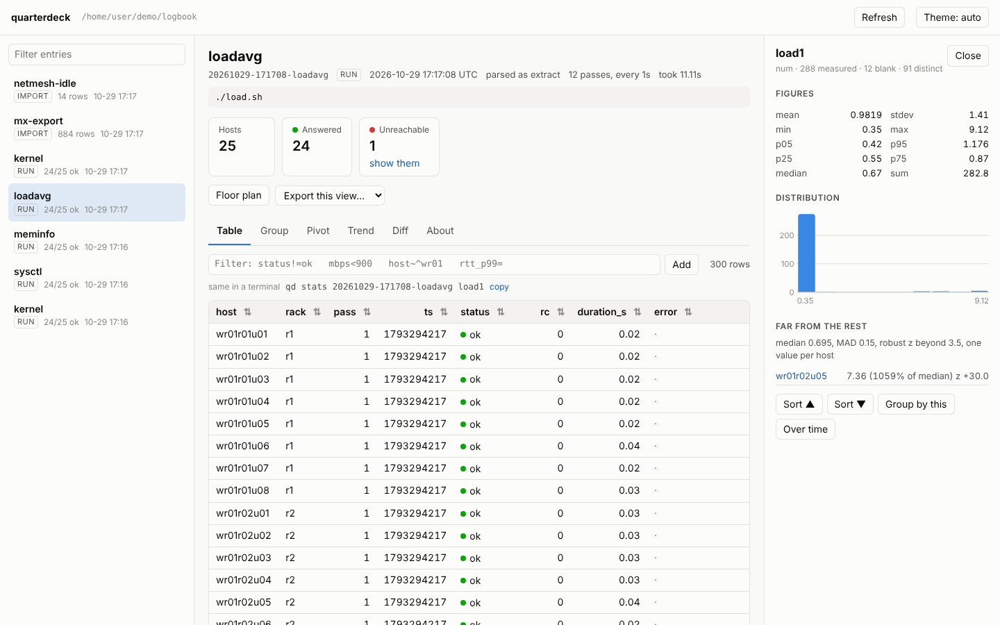
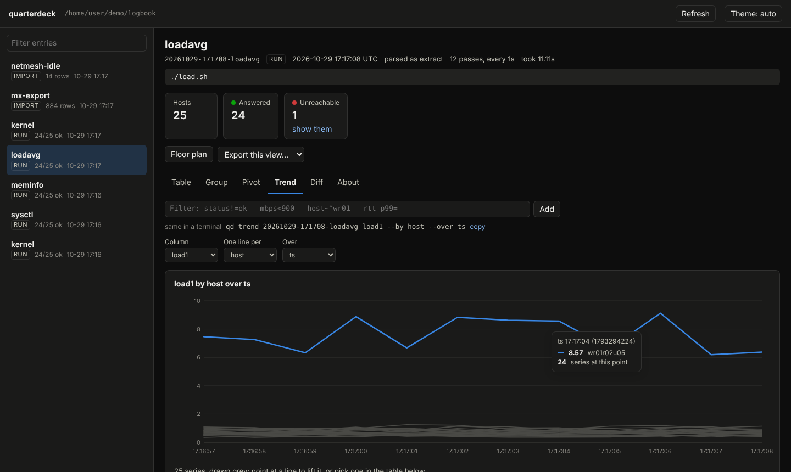
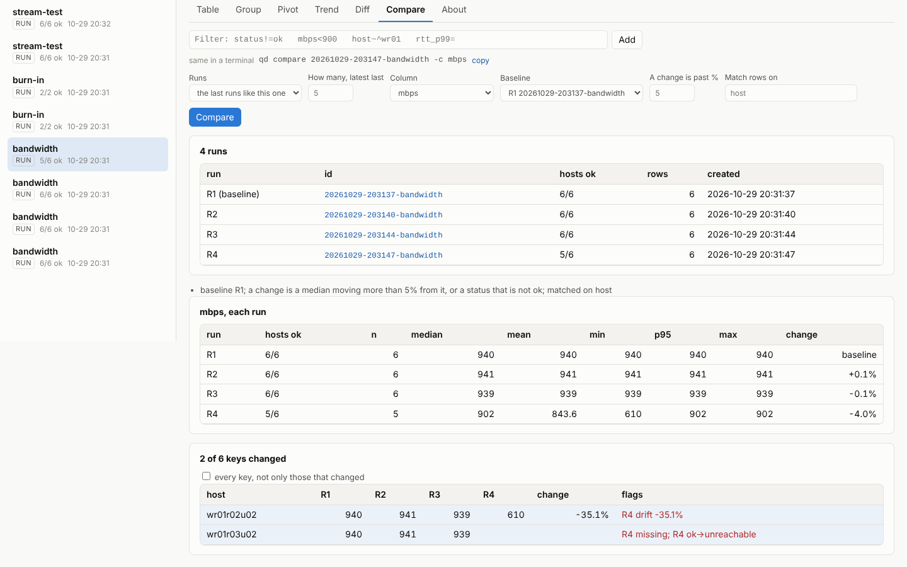

<!--
SPDX-License-Identifier: GPL-3.0-or-later
SPDX-FileCopyrightText: 2026 Martin J. Gallagher
-->

# Reading the answers: tables, statistics, a terminal, a browser

What a run kept, read back: `log`, `show`, `stats`, `freq`, `hist`,
`outliers`, `odd`, `pivot`, `trend`, `diff`, `again`, `--where`, and the
explorers `qd view` and `qd web`. Part of [the manual](README.md).

## Reading it back

All of these take `--where` and `--format text|csv|tsv|json|ndjson|md`
(`-o FILE`). The text is for people; the table behind it is for whatever
comes next.

```bash
qd show latest --where 'status!=ok'           # the rows, aligned
qd show latest --sort -mbps --limit 10 --cols host,mbps
qd stats latest                               # every column described
qd stats latest mbps                          # one column in depth, with a histogram
qd stats latest mbps loss_pct --by rack       # per group (--agg mean,p95,...)
qd freq latest A                              # who said what (A: an unnamed column)
qd hist latest rtt_p99 --bins 20
qd outliers latest mbps                       # far from the median, by MAD
qd outliers latest mbps --peers sku           # far from its own peer group's
qd outliers firmware --categorical            # differs from its rack-mates, by value
qd odd latest                                 # every column at once: who is unlike the rest
qd stats latest mbps --peers sku              # per peer group (qd peers)
qd pivot latest --rows host --cols peer --values pps
qd trend latest load1 --by host --over ts
qd diff latest                                # against the last run of the same thing
qd diff monday tuesday --key host --tolerance 2
qd export latest -o today.ndjson
```

### `--where`

```text
mbps<900                    numbers compare as numbers
status!=ok and host~^wr01   ~ and !~ are regular expressions
status=OK                   text compares without regard to case
rtt_p99=                    blank: not measured
rtt_p99!=                   measured at all
not (loss>0 or rc!=0)
"rtt (us)">200              quote a column name that has spaces
```

Repeat `--where` and every expression must hold. Nothing is evaluated as
Python: the grammar above is the whole language. A blank is never less
than a number. Columns are found by exact name, then without case, then
as a slug (`rtt (us)` is `rtt_us`), then by a unique prefix.

### `freq`: consensus, with names

```text
qd freq -- stdout in 20261029-171708-kernel (25 rows): 4 distinct values
  22 agree on the most common; 3 do not

      22   88.0%  ████████████████████   6.1.0-18-amd64
       1    4.0%  ▉                      (blank)
                                         wr01r04u01
       1    4.0%  ▉                      6.1.0-13-amd64
                                         wr01r03u07
       1    4.0%  ▉                      6.1.0-21-amd64
                                         wr01r01u01
```

When the values are multi-line (a config file, a command's whole
answer), each minority group is shown as a diff against the majority,
which is agree's trick. `--loose` squeezes whitespace and masks numbers
before counting.

### `outliers`: by the median, not the mean

The robust z-score is 0.6745 × (x − median) / MAD, and past 3.5 is an
outlier (Iglewicz and Hoaglin). The median and MAD are used because the
outlier is the thing being looked for: one host at a tenth of the speed
drags the mean and inflates the standard deviation until it hides inside
both. When most of the fleet agrees exactly (MAD of 0), every value that
differs is listed. When hosts repeat (a time series, a mesh), each host is
reduced to its median first, so a hundred rows count as one opinion.
`--method iqr` uses Tukey's fences instead: outside the quartiles by more
than `--k` (1.5) interquartile ranges, scored in IQRs past the nearer
quartile. `--peers NAME` holds each host against its own peer group
(`qd peers`), each group with its own median and spread.

### Who is odd: `qd odd`

`qd outliers` asks about one column, and on a run of fifty columns a
newcomer does not know which to ask about. `qd odd [RUN]` (default:
latest) asks about every one, and lists the hosts unlike the rest, ranked,
with the column, the host's value and the typical one beside it:

```bash
qd odd                          # the latest run: who stands out, and in what
qd odd facts --peers sku        # each host against its own peer group
qd odd latest --top 5 --format csv
```

It is the two checks above, run column by column, and computes nothing of
its own:

- **Numbers** go through `qd outliers`' median and MAD, against the whole
  run (or, with `--peers NAME`, each host's own peer group), a host's
  repeated rows reduced to their median first. They are ranked by how far
  out, in robust z; where most of the run agrees exactly (MAD 0) every
  value that differs is infinitely far, and the column fewer hosts differ
  in comes first.
- **Words** go through `qd outliers --categorical`, within each rack (or
  peer group). They are ranked by **rarity**: the share of the host's group
  that says something else, so one host in twelve on another kernel (92%)
  comes before four in twelve on another SKU (67%).

The two are **two lists**, each ranked on its own scale: a robust z has no
ceiling and a rarity is a share, and putting them on one scale would rank
by the choice of scale, not by how odd a host is. `--top N` (20) limits
each list. `--format` gives one table of both, `list, group, host, column,
value, typical, score, agree`, in rank order.

What it reads: in a `qd run`, what the hosts said (the columns after
`capture`), not the host list's attributes or qd's own bookkeeping; in a
file or another table, every column. Either way it leaves out what is
meant to differ (serials, UUIDs, addresses, host names, uptime, times) and
says so. A column every host agrees in is not checked, and neither is one
**fewer than half the rows measured**: blank is not measured, never zero,
and a host that measured nothing is neither odd nor a vote for the
majority. A host that did not answer the run is named apart. A column
split with no majority has no odd one, and is named too.

The exit status is 1 when any host stands out, 0 when none does, and 2 on
a usage error, so a CI job can gate on it. WHAT TO DO NEXT gives the `qd
outliers` command for the top column of each list, which shows the same
finding in full, and `qd show` for the first host named.

### `diff`: what changed

Rows are matched on key columns, found on their own: `host` for a run,
`test`+`target` for viewer results, `src`+`dst` for a grid,
`source`+`target` for iperf, `host`+`dir`+`peer` for mx reports. Every
shared column is compared, except the ones that differ on every run by
construction (`ts`, `run`, `duration_s`, ...). Those are named rather
than silently dropped, and `--cols` compares them anyway. A key that
repeats is reduced first (numbers by their mean, words by the worst or
most common), and the report says so. With one run, `qd diff` compares
it with the previous run of the same command. `qd compare` lines up more
than two.

Changes are listed worst first: a status that got worse, then a value that
went blank, then the biggest relative change. The exit status is 1 when
anything differs, like `diff(1)`.

### `again`: the same run once more, and what changed

```bash
qd again                 # the latest run, again, then qd diff
qd again kernel          # RUN: any reference qd diff takes (a name, an id, latest~2, ID@STORE)
qd again --dry-run       # what it would run, and nothing more
```

`qd again [RUN]` (default `latest`) answers "what changed since last
time?" without retyping anything. It runs RUN's command again, on RUN's
hosts, with RUN's `--via`, `--sudo`, `--timeout`, `--name` and passes
(`--every`, `--count`), files the new run, then prints `qd diff RUN NEW`.
The hosts are RUN's host file read again when it is still there (`-s
FILE`, `QD_SERVERS`, or the `hosts.txt` it found), so a host added since
is in the new run and shows as new in the diff. When the file has gone,
or the hosts were named some other way (`-S`, a range, `--layout`,
`--rerun`, this machine), they are the hosts RUN ran on, with the
addresses and attributes they ran with.

Before it runs anything it prints the command, the hosts and how they are
reached, and the plain `qd run` it amounts to when that fits on a line.
A `--sudo` run asks `run this as root (sudo) on N hosts? [y/N]` first
when stdin is a terminal; with nothing attached to stdin it never asks,
and `--yes` skips the question. The ssh options that are not part of the
record (`--ssh`, `-u`, `-j`, `--ssh-config`, `--reuse`, `--rate`, ...),
`--max-fail`, `--retries` and the safety flags (`--limit`, `--allow`,
`--read-only`, `--dry-run`) are taken as `qd run` takes them. The run is
`qd run` itself, so filing, the allow-list, the mutation guard and every
`QD_*` variable behave as there. Its summary line is printed, the diff
whole, then which step found what, and WHAT TO DO NEXT with the plain
commands.

The exit status is 0 when every host answered and nothing changed, 1
when a host did not answer or the diff found a change (the summary's
`FOUND` lines say which), and 2 when RUN cannot be run again exactly.
That is a `qd do` run or a `qd import`, a campaign's part (`qd campaign
retry`), a design point (`qd doe run`), a probe (`qd probe NAME` asks it
again), a run that pushed files (`--push`, `--script`: the store does not
keep them), and a run filed before qd 0.40.0, whose record keeps no
`--timeout`. Each says why and what to run instead. `qd.runs` keeps what
`qd again` reads, from 0.40.0 on: `timeout_s`, `pushed` and `host_list`
(the host files, as absolute paths).

---

## In a terminal: `qd view`

A full-screen explorer for when there's no browser: the same views, keyed.

```bash
qd view                # everything in the store: Enter opens, ] [ page
qd view latest         # open on the latest run (q: the store's contents)
qd view f.csv          # a file, without filing it
```

With no RUN it opens on the store's contents: every run, newest first,
then every dataset provost keeps there. Nothing has to be known by name.
Open one and `]` / `[` page to the next and previous table, a run's tables
in turn and then the next run's, on through the datasets; `}` / `{` skip a
whole run. `q` goes back to the contents, on the one you were looking at.

| Keys | |
|---|---|
| arrows, `j` `k`, PgUp/PgDn, Home/End, `0` `$` | move |
| `s` / `S` | sort by this column (again: reverse) / descending |
| `f` | filter: an expression, as `--where` takes one (Tab completes column names) |
| `=` / `!` | keep / drop rows with this cell's value |
| `u` / `F` | undo the last filter / clear every filter |
| `/`, `n`, `N` | search |
| `d` / `D` | this column in depth / every column described |
| `c` | counts of each value and who holds it; Enter filters to one |
| `g` | group by this column; Enter on a group filters to it |
| `h`, `o`, `t` | histogram, outliers, trend |
| `p` | pivot: `rows,cols[,values]` |
| `x` | diff against another run (default: the last of the same thing) |
| Enter | every field of the row, and the host's raw answer |
| `]` / `[` | the next / previous table in the store |
| `}` / `{` | the next / previous run (or dataset) |
| `T`, `L` | another table of this run, everything in the store |
| `e`, `r` | export this view to a file, reload from disk |
| `-`, `*`, `w` | hide a column, show them all, widen one |
| `?`, `q`, `Q` | help, back (from a table: to the contents), quit |

The bottom line always has the current column's figures. A blank cell
stays out of every one.

---

## In a browser: `qd web`

```bash
qd web                         # http://127.0.0.1:8100/, opened for you
qd web --layout floor.dc       # with the floor plan behind "Floor plan"
```

With more than one named store, a picker beside the title reads any of
them (`/api/stores` lists them). The page asks for a store by name, never
by path. The commands it shows under "same in a terminal" carry
`--store NAME`. **Diff** can take its older side (A) from another store,
and **Compare** can add runs from other stores beside the ones it picked:
the API takes a store per side (`a=RUN@STORE` or `a_store=NAME` on
`/api/diff`, `also=RUN@STORE` on `/api/compare`), so the figures are the
engine's, as everywhere.



- **The runs in the store** on the left; the run's command, how many hosts
  answered, and its tables at the top.
- **Campaigns and designs** above the runs, with how far each has got
  (muster's count of parts done, or points measured). One opens its parts
  or points, each with its last run, and **Compare its parts** lines them
  up. A design's page also charts its effects on a column: a Pareto of
  effect sizes, main effects and interactions, and a link to doe's report
  (see [Designed experiments](larger-jobs.md#designed-experiments-qd-doe)).
  A central composite or Box-Behnken design's page has a **Response
  surface** card: doe's fitted model, its stationary point and best point,
  whether the optimum is inside the region or on its edge, and a contour
  chart for each pair of factors (see
  [The response surface](larger-jobs.md#the-response-surface-qd-doe-surface)).
- **Studies** (a screen and the designs that follow it, QD-070), above
  the campaigns and designs: every run of the study in one sortable,
  filterable table, and a response charted against a factor across the
  designs (see
  [A study, every run of it](larger-jobs.md#a-study-every-run-of-it-qd-compare---study-and-qd-web)).
- **Table**: sort on any column and filter with the same `--where`
  language. Click a row for every field and that host's raw answer.
- **A column**: its figures, histogram, outliers and value counts (with who
  holds each value). Click a value to keep or drop it, or a host to filter
  to it.
- **Group**, **Pivot** (shaded per column, or across the whole grid when
  it's one metric), **Trend** (a line per host, with a crosshair and
  tooltip; past eight hosts they're drawn grey and the one you point at
  lifts), **Diff** against any other run, **About** the run.
- **Telemetry**: `qd join` on the page. Pick telemetry the store keeps
  (`qd import --telemetry`), a window, the figures and the metrics, and
  every row of the run comes back with what its host's telemetry said in
  its window. The filter bar reads the joined columns. The server only
  joins what is in a store and never reads a file.
- **Compare**: `qd compare` on the page. The last runs like this one, or
  every run of its campaign or design; a row per run with where the column
  sat and how far it moved from the baseline, then every host's value per
  run, flagged where it drifted or its status went from ok. Click a host
  to open the latest run filtered to it. **Peer groups** adds each group's
  median per run; a **qualified** baseline in the Baseline list holds the
  runs against it, with the drift, effect, p, Holm-adjusted p and verdict
  per peer group, as `qd compare --baseline NAME` prints them.
- **Floor plan** writes the view as an overlay and opens it in the
  datacenter viewer, served by the same server at `/floor/` when
  `datacenter-layout-viewer` is installed. Without `--layout`, use
  *Build from data* in the viewer to read a floor plan out of the
  hostnames.
- **Export** the view, as filtered and sorted, as CSV, TSV, JSON, NDJSON,
  Markdown or a viewer overlay.
- Every view shows **the `qd` command that prints the same thing**, and
  the URL holds the whole view, so a link opens what you were looking at.





The page does no arithmetic of its own. Every figure, group, diff,
comparison and outlier comes from the same functions the terminal verbs
print, so the
browser and the terminal can't disagree about a number. There's no build
step and no dependency, just three static files and a JSON API served by
the standard library. It listens on 127.0.0.1 unless you pass `--host`
(`QD_WEB_HOST`, `QD_WEB_PORT`; see *Sharing it on the network* below). It's read-only, except that "Floor plan"
writes the overlay into qd's cache (never the store, which provost commits
whole), as `qd floor` does.

Over ssh to a jump host, forward the port. This is still the best way to
reach it from elsewhere: nothing is exposed, and ssh does the encryption.

```bash
ssh -L 8100:127.0.0.1:8100 jumpbox qd web -n
```

### Sharing it on the network

Listening anywhere but 127.0.0.1, localhost or ::1, `qd web` needs a token
on every request, and turns away the Floor plan button's write:

```bash
qd web --host 0.0.0.0                       # makes a token and prints it once, in the link
QD_WEB_TOKEN=... qd web --host 0.0.0.0      # or give one (16+ characters)
qd web --host 0.0.0.0 --token-file ~/.qd-token \
       --tls-cert cert.pem --tls-key key.pem   # https
qd web --host 0.0.0.0 --allow-writes        # let Floor plan write into qd's cache
```

- **The token** is the printed link's `?token=...`. Opening the link stores it
  in a cookie (HttpOnly, SameSite=Strict, Secure under https) and takes it
  out of the address bar. A script sends `Authorization: Bearer TOKEN`. A
  token you give (`QD_WEB_TOKEN`, or `--token-file`/`QD_WEB_TOKEN_FILE`, the
  file's first line) is never printed, and no token is ever logged.
- **Giving a token on 127.0.0.1 makes it required there too.** That is for
  a login node, where 127.0.0.1 is shared by every user on it. With no token,
  loopback works as it always has.
- **Without `--tls-cert`** (`QD_WEB_TLS_CERT`, and `--tls-key`/`QD_WEB_TLS_KEY`
  unless the key is in the same file) the token and the data cross the
  network in the clear, and `qd web` says so when it starts.
- **Read-only beyond this machine.** The overlay is the only thing the page
  writes; `--allow-writes` lets it.
